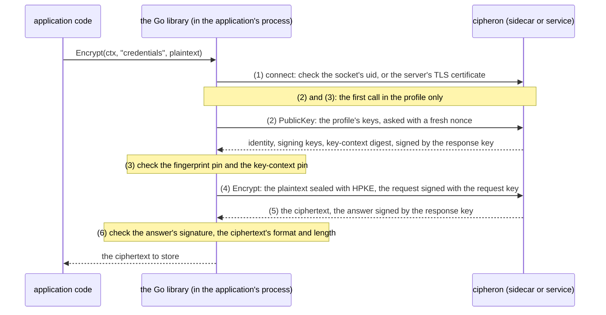

# The Go library: `github.com/nnicora/cipheron`

`github.com/nnicora/cipheron` is the Go library an application uses to have cipheron encrypt, decrypt, re-encrypt and
sign its data. It is the whole client: an application calls Encrypt, Decrypt, ReEncrypt and Sign with a profile name
and its bytes, and never deals with gRPC, TLS, HPKE or a key. It checks every answer before returning it. Underneath
it is the protocol client, `internal/client`, which no application imports ([What you import](#what-you-import)). The
library belongs to the application developer, who sets it up before the first release that calls cipheron (cipheron's
operating model, section *Step 11 — Application developer — before the first release that calls cipheron*).

**Who this page is for.** A developer who writes the Go code that calls cipheron, and whoever reviews that code. It
assumes Go, not cryptography or security: the words it needs are explained once, in
[Words this page uses](#words-this-page-uses), and in full in cipheron's glossary.

**How to read it.** It is a reference: readers look things up. Read [Choosing a setup](#choosing-a-setup) and
[Making a Client](#making-a-client) first; then [Shared profiles](#shared-profiles) or
[perTenant profiles](#pertenant-profiles), whichever your profile is; and keep [Errors](#errors) open while you write the
error handling. The other sections answer a question when you have it. The package's own documentation
(`go doc github.com/nnicora/cipheron`) and its runnable [examples](#examples) are the source of truth this
page follows.

- [What you import](#what-you-import)
- [Words this page uses](#words-this-page-uses)
- [What one call does](#what-one-call-does)
- [Choosing a setup](#choosing-a-setup)
- [Making a Client](#making-a-client)
- [Options](#options)
  - [The pins are re-read live](#the-pins-are-re-read-live)
  - [Retries](#retries)
  - [The observer and request ids](#the-observer-and-request-ids)
  - [Balancing across replicas](#balancing-across-replicas)
  - [From the sidecar chart's environment](#from-the-sidecar-charts-environment)
- [Shared profiles](#shared-profiles)
- [perTenant profiles](#pertenant-profiles)
- [Verifying signatures without cipheron](#verifying-signatures-without-cipheron)
- [Associated data](#associated-data)
- [Batches and large objects](#batches-and-large-objects)
- [Moving a ciphertext to another profile](#moving-a-ciphertext-to-another-profile)
- [Publishing the signing keys: the key statement](#publishing-the-signing-keys-the-key-statement)
- [Finding rows to migrate](#finding-rows-to-migrate)
- [Errors](#errors)
  - [The order to test errors in](#the-order-to-test-errors-in)
- [Pins, trust on first use, and rotations](#pins-trust-on-first-use-and-rotations)
- [The protocol version](#the-protocol-version)
- [Request keys](#request-keys)
- [Concurrency, connections and sizes](#concurrency-connections-and-sizes)
- [Performance](#performance)
- [Examples](#examples)

## What you import

```go
import "github.com/nnicora/cipheron"
```

An application imports three packages of this module, and no other:

| package | what it holds | imported by |
| --- | --- | --- |
| `github.com/nnicora/cipheron` | the library: `Client` and its options, the errors, offline verification (`VerifyWithKeys`), key statements, tenant key blobs read offline (`ReadTenantKey`), the operation names (`Operation`, `OpEncrypt` and the other `Op*` constants: what an audit event and a caller entry's grant name a call by, and what `cipherontest`'s `Grant` takes), the gRPC metadata key a call's request id travels in (`RequestIDMetadataKey`), and a segmented object's framing ([below](#batches-and-large-objects)) | the application |
| `cipherontest` | a test server that speaks the protocol (cipheron's `testing-apps-with-cipherontest` example) | the application's tests |
| `conformance` | the protocol's vectors and a runner that holds an implementation in any language to them ([api.md](../spec/api.md#conformance-kit)) | another client's tests |

Under them are two other kinds of package. The protocol client is `internal/client`, and **the compiler keeps it
out of reach:** Go refuses to import a package under `internal/` from another module (`use of internal package … not
allowed`). The protocol itself — the transcripts, the ciphertext and blob layouts (`wire/transport`), the format
framework (`wire/format`) and the peer-credential check (`peercred`) — is exported, because cipheron's server and other
implementations of the protocol use it; it is versioned with the protocol and an application does not import it. A
type the calls take or return that is defined underneath is re-exported by `github.com/nnicora/cipheron` under a name
of its own (`CiphertextKey`, `SegmentedHeader`, `Operation`, `KeyStatement` and the like are aliases), so an
application can always name what it holds. The three packages' whole exported surface is `testdata/api.txt`, which a
test holds equal to the code: a change to what applications can see is a diff of that file.

## Words this page uses

Each term in one or two sentences; cipheron's glossary has the full entry.

- **profile** — a named set of keys inside cipheron, such as `credentials`. Every call names one, and what a caller may
  do is decided per profile.
- **sidecar, unix socket; network service, mutual TLS** — cipheron runs either beside the application, in the same
  pod, and is reached on a **unix socket** (a file path the operating system turns into a local connection), or as a
  shared service reached over the network with **mutual TLS** (TLS in which both sides show a certificate, so each
  knows who the other is).
- **SPIFFE ID** — the workload name a certificate carries, such as `spiffe://prod.example.org/ns/platform/sa/cipheron`.
  On the network cipheron knows a caller by it, and the client may check the server by it.
- **identity, fingerprint, pin** — a profile's **identity** is what never changes about it: its HPKE public key
  (requests are sealed to it), its response public key (answers are signed with its private half) and its tenancy. Its
  **fingerprint** is a SHA-256 digest of the profile's name and identity, written `sha256:` and 64 hex digits. To
  **pin** is to give the application the fingerprint in advance, so it refuses keys with any other.
- **trust on first use** — what happens without a pin: the client trusts the identity that answers first and refuses
  a different one later. Weaker than a pin: an impostor that answers first is believed.
- **key context, key-context digest** — a profile's key configuration (its master versions and published signing keys)
  and a SHA-256 digest of it. Replicas that answer the same digest read each other's ciphertexts; a replica that answers
  another serves other keys.
- **request key** — an Ed25519 key pair (Ed25519 is a modern signature algorithm) that belongs to the caller: the
  private half signs each request, so cipheron knows it comes from that caller, even through a proxy.
- **HPKE** — Hybrid Public Key Encryption (RFC 9180): how the library seals a plaintext so that only the profile's
  cipheron can open it, even where TLS is ended on the way.
- **nonce** — a random value used once. A fresh one in every request stops a recorded request or answer from being
  played again.
- **tenancy** — whether a profile has one set of keys for every caller (**shared**) or a key per tenant: **perTenant
  wrapped**, where cipheron makes the tenant's key and the application stores it as a **tenant key blob** (the key,
  encrypted under the profile's tenant-wrapping key), or **perTenant derived**, where the tenant's key is computed from
  the profile's keys and nothing is stored.
- **master version** — a profile's master key is kept as numbered **versions**. Every ciphertext names the version it was
  made under.
- **ciphertext format** — the layout of the bytes Encrypt returns, numbered 3 to 6 in their header; it tells what
  the ciphertext was made under. [api.md](../spec/api.md#ciphertext-formats)
- **associated data** — context, such as a row's key, bound into a ciphertext without being stored in it, so the
  ciphertext decrypts only in that context.
- **transcript version** — the version number bound inside everything both sides sign or seal: each side writes the
  version its release writes and checks under every version the release reads (today both are `1`); nothing is
  negotiated.
- **sentinel error** — a fixed error value the package exports, such as `cipheron.ErrBusy`. A call's error wraps one
  of them; the application tests it with `errors.Is`, never by the message.

## What one call does



**How to read this diagram.** Time runs downwards; solid arrows are requests, dashed ones answers. (1) A connection is
opened only when a call first needs one, and before anything is sent the library checks that the other end is
cipheron: on the socket by the uid the kernel reports, on the network by the server's certificate. (2) and (3) happen
once per profile for the life of the Client: the library fetches the profile's public keys and accepts them only if they
match the pins. (4) The plaintext leaves the process sealed to the profile's HPKE key, so nothing between the
application and cipheron can read it; with a request key, the request is signed too. (5) and (6) The answer is signed
by the profile's response key over this very request, and the library checks the signature and the ciphertext before
returning it: an answer that fails is never returned. Decrypt is the same path; its plaintext comes back sealed to a
key the library made for that one call.

## Choosing a setup

| where your application runs | make the Client with | why this way |
| --- | --- | --- |
| in a pod whose cipheron sidecar the `cipheron-sidecar` Helm chart installed | `cipheron.New("", cipheron.WithEnvironment())` | the chart sets the socket, cipheron's uid, the request key (when the caller has one) and the pins in the container's environment, and the library reads exactly those: nothing is copied by hand. In production it requires a pin for every profile ([below](#from-the-sidecar-charts-environment)) |
| beside a cipheron that listens on a unix socket, without the chart | `cipheron.New(socketPath, cipheron.WithServerUID(10443), cipheron.WithProfileFingerprint(profile, fp), cipheron.WithRequiredPins())`, and `cipheron.WithRequestKeyFile(path)` when the caller entry lists request keys | the uid (the one cipheron runs as: 10443 in its image) proves the socket's listener is cipheron; the pin proves the profile's keys are the profile's; `WithRequiredPins` turns a forgotten pin into an error instead of trust on first use |
| anywhere, reaching cipheron over the network | `cipheron.New("host:port", cipheron.WithTLSFiles(cert, key, ca), cipheron.WithRequestKeyFile(path), cipheron.WithProfileFingerprint(profile, fp), cipheron.WithRequiredPins())`, and `cipheron.WithServerSPIFFEID(id)` when the server is named by its SPIFFE ID | TLS checks the server's certificate and gives cipheron the caller's SPIFFE ID; the request key is required on the network, so whoever ends TLS on the way can neither forge nor redirect a request, and can replay one at most once to each cipheron process alive at its timestamp, within `maxSkew` (the replay cache: cipheron's security guide, section *The replay cache*); the pin keeps the payloads and answers end to end |
| in the application's own tests | `cipherontest` (a fake cipheron on a temporary socket) and `cipheron.WithAnyServer()` | the fake runs as the test's own user, so there is no cipheron uid to check. Never in a deployment (**Testing** under [perTenant profiles](#pertenant-profiles); worked: cipheron's `testing-apps-with-cipherontest` example) |

**Why not one setup for every case?** The two transports know a caller in different ways: on the socket cipheron
reads the caller's uid and gid from the kernel, on the network it reads the SPIFFE ID of the caller's certificate. The
client checks the server the matching way. What is the same everywhere is the pin: it is what makes every setup safe
against a party that is not the profile's cipheron.

## Making a Client

```go
func New(address string, opts ...Option) (*Client, error)
func (c *Client) Close() error
```

`New` makes a **Client**: the application's handle on cipheron, holding a small pool of connections and what it has
learnt about each profile. `address` says where cipheron is, and is read as:

| written | is |
| --- | --- |
| `unix:///run/cipheron/private/cipheron.sock` | a socket; the path after `unix://` must be absolute |
| anything containing `/` (`/run/cipheron/private/cipheron.sock`, `./x.sock`) | a socket path (made absolute) |
| `host:port`, a host and a port 1 to 65535 | a network address |
| a bare name with no `:` | a socket path relative to the working directory |
| `""`, with `WithEnvironment()` | the socket the sidecar chart's environment names ([below](#from-the-sidecar-charts-environment)) |

Anything else is refused, never guessed: an address read the wrong way would send the requests somewhere else.
**Which socket path:** cipheron listens where its `socket.path` says; unset, that is
`/run/cipheron/cipheron.sock`, or `/run/cipheron/private/cipheron.sock` with `socket.privateDirectory: true` (cipheron's
own directory inside a parent others may write). The charts set `privateDirectory: true`, so in a pod the socket is
`/run/cipheron/private/cipheron.sock` — what `CIPHERON_SOCKET` says (cipheron's configuration reference, section *`socket`*).

A **socket** address needs `WithServerUID` or `WithAnyServer` (exactly one) and refuses the TLS options. A **network**
address needs `WithTLSFiles` or `WithTLSConfig` (exactly one) **and** a request key (`WithRequestKeyFile` or
`WithRequestKey`), and refuses `WithServerUID`/`WithAnyServer`. `New` reads the files the options name (TLS files, the
request key, the pins directory) once, and does **not** connect: the first call does, and waits for cipheron until its
context ends — an application may start before cipheron has unsealed. `New`'s errors are configuration errors
([below](#errors)).

**Why the address decides which options apply.** On the socket the kernel can say which user runs the process at the
other end, so the server is checked by its uid; on the network there is no such kernel, so the server is checked by
its certificate, and the caller is known by its own certificate and request key. An option of the other transport
would check nothing, so `New` refuses it rather than ignore it.

**Why `New` does not connect.** In a pod the application and its cipheron sidecar start together, and cipheron may
still be *unsealing* (fetching its master keys from the KMS, the system that keeps them) when the application starts.
A constructor that connected would fail the application's start for no fault of its own; a first call that waits,
bounded by its own context, does not. unseal

**One Client per process.** Make it at start-up, share it (it is safe for concurrent use) and `Close` it at shutdown. A
new Client is not cheap: `New` reads its files again and makes its gRPC channels; its first call opens a connection (a
TCP and mutual-TLS handshake, or a connect and the check of cipheron's uid) and fetches the profile's keys; nothing a
previous Client learnt (a profile's keys, a signing rotation, a revocation) is carried over. cipheron bounds the
connections one caller may have open (`maxConnectionsPerCaller`, 32 unless configured) and closes the ones beyond it
without an answer — which to a client looks like a server that is not up yet: a process that makes a Client per request
and does not close each one ends up with calls that wait until their deadlines.

**`Close`** closes the connections and wipes the request key the Client holds (crypto/ed25519's own cache of the key's
expansion stays until the collector reclaims the key). Afterwards every call fails with `ErrClosed` and sends nothing; a
call in flight is cut short and fails with `ErrClosed` too. It is safe to call more than once (the later calls return
nil) and concurrently with calls: no request is ever signed with a wiped key.

## Options

An option is a value passed to `New` that sets one thing about the Client. Each answers one of these questions:

- **Is the server cipheron?** `WithServerUID` on the socket; `WithTLSFiles` or `WithTLSConfig`, with
  `WithServerSPIFFEID` when the server is named by its SPIFFE ID, on the network. `WithAnyServer` turns the check
  off, for tests.
- **Who is the caller?** On the socket the kernel tells cipheron the caller's uid and gid; on the network the client
  certificate (`WithTLSFiles`, `WithTLSConfig`) says it. On both, `WithRequestKeyFile` or `WithRequestKey` signs each
  request but the key fetch.
- **Are the profile's keys the right ones?** `WithProfileFingerprint`, `WithContextDigestPin`, `WithWriterVersionPin`,
  `WithTenantFingerprint`, `WithPinsDir` and `WithRequiredPins` (the pins); `WithKeysMaxAge` (how fresh the signing-key list must be).
- **How does it behave under load and failure?** `WithConnections`, `WithRoundRobin`, `WithRetry`,
  `WithMaxMessageBytes`.
- **Which protocol does it speak?** `WithTransport`: gRPC unless it says otherwise.
- **What do the operators see?** `WithObserver` ([the observer](#the-observer-and-request-ids)).
- **All of it from the sidecar chart:** `WithEnvironment`.

In the table, **For** says what an option is for, and **Why** explains a default where a reader would ask.

| option | applies to | what it does | refused when |
| --- | --- | --- | --- |
| `WithServerUID(uid uint32)` | socket | **For:** proving that the process on the socket is cipheron before anything is sent to it — a socket path is only a file name, and a process that took it while cipheron was down would otherwise receive the requests. On every connection, before anything is sent, checks that the process listening on the socket runs as `uid` (the kernel's word: `SO_PEERCRED`, `LOCAL_PEERCRED`, its peer credentials); another fails the call at once with `ErrServerIdentity`. cipheron's image runs as `10443`. **Why that uid:** it must be cipheron's alone on the host, so an impostor would need that uid, or root. On platforms other than Linux and Darwin a client with it cannot connect | with a network address; with `WithAnyServer`; a uid that names no one in particular — `0` (every root process would pass), `65534` and the kernel's overflow uid, `4294967294`/`4294967295` — the list cipheron's server refuses as callers; given twice with different uids |
| `WithAnyServer()` | socket | **for tests and development only**: the explicit opt-out, no server authentication. The Client talks to whatever process answers on the path; without a pin that process reads every plaintext given to Encrypt and all data given to Sign, and its answers are accepted; with a pin it can read and answer nothing, but still receives the sealed requests and can fail every call. `New` does not refuse it, so nothing but review keeps it out of a deployment. Production: `WithServerUID`, a pin per profile, `WithRequiredPins` | with a network address; with `WithServerUID` |
| `WithTLSFiles(certFile, keyFile, caFile string)` | network | **For:** a network client: the certificate tells cipheron who the caller is (its SPIFFE ID), and the CA bundle tells the client which server certificates to accept. The client's certificate chain and key (PEM), re-read on every handshake (a rotated certificate is picked up without a restart; if a re-read fails, the last one is used until it expires), and the CA bundle the server's certificate must verify against, read once. Each file through the checked reader: owned by root or this process's user, not writable by others, the key readable by no one else (`0400`, `0440`, `0600`, `0640`) and with a single hard link, absolute paths. TLS 1.3 at least. **Why TLS 1.3:** cipheron's listener serves it, and only a TLS 1.3 alert is authenticated, which is what lets a refused certificate fail the call at once ([errors](#errors)) | with a socket; with `WithTLSConfig`; given twice with different files |
| `WithTLSConfig(cfg *tls.Config)` | network | **For:** an application that already has a TLS configuration, for example go-spiffe's Workload API one, which fetches and renews its certificates. Cloned. It must present a client certificate (`Certificates` with a chain, a key and a parsable leaf, or `GetClientCertificate`) and verify the server with its own `RootCAs` or its own `VerifyConnection`/`VerifyPeerCertificate`; never the system's roots, never `InsecureSkipVerify` without a verification of its own. **Why not the system's roots:** they trust every public certificate authority, so a certificate any of them issued, to anyone, would pass as cipheron. One that sets no `MinVersion` gets TLS 1.3; one that sets TLS 1.2 keeps it (for a cipheron whose `network.tls.minVersion` is `"1.2"`) and gives up, on a TLS 1.2 connection, the immediate `ErrPermissionDenied` when cipheron refuses the certificate ([below](#errors)) | with a socket; with `WithTLSFiles` |
| `WithServerSPIFFEID(id string)` | network | **For:** a server known by its SPIFFE ID rather than by a host name, as in a SPIFFE deployment, where certificates name workloads. Accept only a server whose chain verifies against the configuration's `RootCAs` (for serverAuth) and whose certificate carries exactly one URI SAN, `id` — instead of checking the address's host name | with a socket; without `RootCAs`; given twice with different ids |
| `WithRequestKeyFile(path string)` | both | **For:** proving that each request is this caller's, even to a cipheron reached through a party that holds a connection identity of the same name (a proxy that ends TLS): cipheron refuses a request forged or sent to another profile, and serves a replay at most once by each process alive at its timestamp ([request keys](#request-keys), the replay cache (cipheron's security guide, section *The replay cache*)). The caller's request private key: one PEM `PRIVATE KEY` block (PKCS #8, Ed25519), as OpenSSL 3 writes it ([request keys](#request-keys)), at most 16 KiB, absolute path, owned by root or this user, readable by no one else, with a single hard link, in a directory chain no one else can write; its bytes wiped once parsed. Every request but PublicKey is signed with it | with `WithRequestKey`; given twice with different files |
| `WithRequestKey(key ed25519.PrivateKey)` | both | **For:** a key the application loads itself rather than from a file. The same as `WithRequestKeyFile`, for a key the application holds: copied when the option is made (the application may wipe its own slice as soon as `WithRequestKey` returns), and each Client made with the option holds a copy of its own, which its `Close` wipes | not 64 bytes; with `WithRequestKeyFile`; given twice with different keys |
| `WithProfileFingerprint(profile, fp string)` | both | **For:** making sure the profile's keys come from the profile's cipheron: with a pin, no other party can read a payload or have an answer accepted ([pins](#pins-trust-on-first-use-and-rotations)). The identity never rotates, so a pin survives every key rotation. Pins the profile's identity to `fp` (`sha256:` and 64 lower-case hex digits, as `keygen ensure` printed it); repeat per profile | an empty profile; a malformed fingerprint; one profile pinned to two |
| `WithContextDigestPin(profile string, digests ...string)` | both | **For:** refusing a replica that serves the right profile with other keys (a configuration that drifted, or one not rolled out yet): its identity, so its fingerprint, is the same, and only the digest tells it apart. Pins the profile's **key context** to `digests` (each `sha256:` and 64 lower-case hex digits, as `keygen ensure` printed `contextDigest`): the profile's keys are accepted only when the key-context digest cipheron answers — signed by the profile's response key — is one of them, and **every answer** only when it verifies under one of them (the response signature covers the answering replica's key-context digest), so a data call a replica on another context answers is refused as surely as its key fetch: `ErrContextDigest` (an answer under a context this Client never saw a PublicKey answer give: `ErrServerIdentity`), and nothing of the answer is used. Two (old and new) while a key-context change rolls out (the rollout order: cipheron's operating model, section *Rolling a key-context change behind context pins*); given twice for a profile, the lists are joined | an empty profile; no digest; a malformed digest; more than 8 for one profile |
| `WithWriterVersionPin(profile string, versions ...string)` | both | **For:** naming which master versions new data may be made under; the key-context digest covers which versions are listed, not which one writes, so a replica that lags a writer switch answers under a pinned digest. An answer that makes new data — Encrypt, ReEncrypt and their batches and the helpers built on them (the ciphertext's master version, shared and derived profiles), CreateTenantKey and the rewraps (the blob's wrapping version, wrapped profiles) — is accepted only when that version is one of `versions`, else `ErrContextDigest` and nothing of the answer is returned. Reads are not held to it. A writer switch is then a pin change too: widen (old and new), switch, narrow (new only). Given twice for a profile, the lists are joined; fixed for the Client's life (no pins-directory file) | an empty profile; no version; a version that is not a master version id; more than 8 for one profile |
| `WithPinsDir(dir string)` | both | **For:** pins delivered as files (a mounted ConfigMap) that the operators change without a change to the code or a restart. Reads the profiles' pins from `dir` — `<profile>.fingerprint` and `<profile>.contextDigest` files, the same rules as `WithEnvironment`'s pins directory ([below](#from-the-sidecar-charts-environment)) — and **re-reads it while the Client runs** ([live pins](#the-pins-are-re-read-live)). For a client without `WithEnvironment`, such as a network client that mounts its pins ConfigMap. Implies nothing: add `WithRequiredPins` | a relative path; a directory that cannot be read in full or holds anything but pins; with `WithEnvironment`, another directory than `CIPHERON_PINS_DIR`; given twice with different directories |
| `WithRetry(p RetryPolicy)` | both | **For:** riding out short refusals (cipheron busy, a replica draining) without a retry loop of your own. **Opt-in**: an idempotent call (one whose second execution changes nothing) refused for a transient reason is sent again, each attempt a fresh request ([retries](#retries)). Off by default | `MaxAttempts` outside 2–10; a backoff outside 1 ms–30 s or `InitialBackoff` above `MaxBackoff`; given twice with different policies |
| `WithRequiredPins()` | both | **For:** every deployment: a profile someone forgot to pin fails, instead of being trusted on first use. Requires a pin for every profile the Client uses: a profile with no fingerprint (`WithProfileFingerprint`, or a `<profile>.fingerprint` file in the pins directory) is not trusted on first use — its first call fails with `ErrPinRequired` (which is also `ErrServerIdentity`), before anything is asked of cipheron. Use it with `WithEnvironment()`, so that a pin missing from a deployment is an error, not a silent fall back to trust on first use | — (with `WithEnvironment`, an empty pins directory and no `WithProfileFingerprint`: `New` fails, [below](#from-the-sidecar-charts-environment)) |
| `WithTenantFingerprint(profile, tenant, fp string)` | both | **For:** catching a tenant key blob swapped where the application stores it (another key of the tenant, say). Pins a wrapped tenant's key to the fingerprint CreateTenantKey answered: a Tenant handle (or RewrapTenantKey) given another key's blob fails with `ErrTenantKey` before anything is sent; repeat per tenant | an empty profile or invalid tenant; a malformed fingerprint; one tenant pinned to two |
| `WithMaxMessageBytes(n int)` | both | the largest message sent or received; default 64 MiB + 64 KiB. **Why that default:** 64 MiB is the most cipheron can be configured to accept in one request (its listener's `maxRequestBytes`), and the 64 KiB is room for what a message adds to its payload. Lower it to refuse large data in the application before it is sent. It also bounds a segmented object's segments: a segment's request must fit three quarters of (`n` − 1 KiB), so a segment of 16 MiB needs `n` of about 21.3 MiB at least (the default admits every segment size), and a smaller `n` refuses a larger `WithSegmentSize` with `ErrTooLarge` before anything is sent | below 4096 or above 2^31−1 |
| `WithConnections(n int)` | both | gRPC connections kept, used round robin; default 2 — the client's pool size. **Why a small number:** each gRPC connection carries any number of calls at once, and every connection of every Client and process of the same caller counts against cipheron's bound (`maxConnectionsPerCaller`, 32 unless configured). Raise it for many large requests at once: cipheron works on at most two maximum-size requests per connection (answer budget: cipheron's operations guide, section *Answers per connection*). With `WithRoundRobin` each is one connection to every resolved replica. | below 1 or above 16 |
| `WithTransport(t Transport)` | both | **For:** a client that must speak cipheron's JSON API instead of gRPC (a proxy that passes HTTP/1.1 only, say). `TransportGRPC` (the default) or `TransportHTTP`: the JSON API over HTTP/1.1, on the socket without TLS, on the network over mutual TLS. Trust is unchanged: the payloads are sealed and signed as gRPC's are, and every answer is checked the same way. **Why gRPC by default:** an HTTP/1.1 connection carries one call at a time (`WithConnections` connections, 8 unless given), a call does not wait for a connection (it fails `ErrUnavailable` at once), and base64 in JSON costs about 20 times the payload in allocations | a value that is not a `Transport`; given twice with different values; `TransportHTTP` with `WithRoundRobin` |
| `WithRoundRobin()` | network, gRPC | **For:** using every replica of a network cipheron, not only the few a load balancer happened to pick for this client's connections. Spreads calls over **every address the host name resolves to**: gRPC's DNS resolver and its `round_robin` policy, one verified connection per resolved address per pooled connection ([balancing](#balancing-across-replicas)). Use it with the cipheron chart's `service.headless: true` | with a socket address |
| `WithKeysMaxAge(d time.Duration)` | both | **For:** bounding how late a signing-key revocation (an operator withdrawing a key, usually after a compromise) reaches this Client. A shorter `d` sees a revocation sooner and asks cipheron for the list at least that often; a longer one asks less and sees it later. How old, at most, a profile's signing-key list may be when `Verify` (the Client's, a derived profile's `Tenant.Verify`) decides on a signature, and when `Sign` judges the key its answer names; default 5 minutes. The age is measured on the monotonic clock: a wall clock stepped back never makes an old list fresh, and a negative age counts as stale. An older list is fetched again first, so a revoked key is refused at most `d` after the revocation reached the cipheron that answers; when that fetch fails, `Verify` fails closed with `ErrKeysStale`, and `Sign` returns `ErrKeysStale` and no signature — online verification and online signing need cipheron's PublicKey reachable at least once every `d`. A failed fetch is not retried for 5 seconds (the calls meanwhile answer `ErrKeysStale`). The other calls do not look at the list's age | below 5 seconds or above 24 hours; given twice with different values |
| `WithObserver(f func(profile, kind string))` | both | **For:** letting the operators see the errors only a client sees — cipheron's own metrics never see them. `f` is told, at the end of a call that failed with one, the call's profile and a fixed `kind`: `context_digest`, `server_key_changed`, `server_identity`, `keys_stale`. It is also told `retry` before each attempt `WithRetry` makes after the first and before the one resend after a `CIPHERON_STARTING` refusal ([retries](#retries)), and `pins_reload_failed` when an update of the pins directory is not applied (`cipheron.ObserverKinds` lists the six). It is never told the error itself, a tenant or a payload. `f` runs on the calling goroutine (or the pins directory's) and may run concurrently: keep it fast and safe for concurrent use, such as incrementing a counter ([the observer](#the-observer-and-request-ids)) | — (given twice, the last one is used) |
| `WithEnvironment()` | socket | **For:** an application in a pod the `cipheron-sidecar` chart installed: what the chart sets, the library reads, so nothing is copied by hand. The address, `WithServerUID`, `WithRequestKeyFile`, a `WithProfileFingerprint` per fingerprint pin and a `WithContextDigestPin` per key-context pin, from the environment the `cipheron-sidecar` chart sets ([below](#from-the-sidecar-charts-environment)). **In production (`CIPHERON_ENVIRONMENT` unset or anything but `development`) it requires the pins**: no pins directory is `ErrPinRequired`, and `WithRequiredPins` is implied | a required variable missing, a set one empty or malformed; in production, no `CIPHERON_PINS_DIR`, or a pins directory that pins no profile (with no option pinning one); with an address, `WithAnyServer`, `WithServerUID` of another uid, `WithRequestKey` or `WithRequestKeyFile` of another file while `CIPHERON_REQUEST_KEY` is set, or another fingerprint for a pinned profile (an option equal to the environment's value is accepted) |

**The rules for options:**

- A nil `Option` is skipped.
- An option that answers one question — `WithServerUID`, `WithServerSPIFFEID`, `WithTLSFiles`, `WithRequestKeyFile`,
  `WithRequestKey`, `WithKeysMaxAge`, `WithRetry`, `WithPinsDir`, `WithTransport`, a profile's or a tenant's
  fingerprint — may be given twice with the **same** value; given twice with **different** values, `New` fails rather
  than let the last one win. **Why:** which of two answers was meant is not guessed, and a security setting must not
  be replaced silently by a later option. `WithTLSConfig` and `WithObserver` are the exceptions: two configurations or
  two functions are not compared, so the last one given is used. `WithContextDigestPin` and `WithWriterVersionPin`
  given twice for a profile join the lists.
- Pins given in code — `WithProfileFingerprint`, `WithContextDigestPin`, `WithWriterVersionPin`,
  `WithTenantFingerprint` — are fixed for the
  Client's life. A service that rotates a pinned tenant key makes a new Client with the new pin. The pins **directory**
  (`WithEnvironment`'s `CIPHERON_PINS_DIR`, or `WithPinsDir`) is re-read live ([below](#the-pins-are-re-read-live)).

### The pins are re-read live

**What it is for.** A key-context change is rolled out behind the context pins in steps: the applications first accept
the old and the new digest (a *widen*), the replicas then move to the new key context, and the applications finally
accept only the new digest (a *narrow*)
(the rollout order: cipheron's operating model, section *Rolling a key-context change behind context pins*). Re-reading the pins
directory lets each step reach running applications without restarting them. **Why not fixed for the Client's
life:** then every widen and every narrow would need every application rolled out. Owner decision D-P (ops review
2026-11-13, item 16) makes the pins **directory** live — `CIPHERON_PINS_DIR` under `WithEnvironment()`, or
`WithPinsDir(dir)`:

- The Client looks at the directory every 10 seconds. A Kubernetes configMap, secret or projected volume is read again
  only when its `..data` link moved — the kubelet (the Kubernetes agent that writes a pod's mounted
  files) writes the new files into a new timestamped directory and swaps the link atomically, so a read never sees
  half an update. Any other directory is read again whole.
- A read that is whole, and that `New` would have accepted, becomes the pins in force at once — together with the pins
  given in code, which a file can add digests to and never remove. **A key-context widen (old and new digest) and narrow
  (new only) need no restart of the application.** Keys a profile cached under other pins are checked against the new
  ones before their next use, and so are keys a fetch returns that began under the older pins (`Keys`,
  `KeyStatement`, `Verify`'s refresh): after a narrow, a replica still answering the old digest — to a key fetch or to
  a data call — is `ErrContextDigest`.
- **Never fail-open** (an error never leaves the Client less protected than before). An update that cannot be read in
  full, or holds anything `New` refuses (a file that is no pin, a digest that is no digest, more than 8 digests for a
  profile with the code's own, a directory others can write), is **not applied**: the pins in force stay. A profile
  whose pin file **disappears keeps its pins** — an update never turns a pinned profile into an unpinned one, which
  would hand it to trust on first use; a restart drops them. A profile's **fingerprint never changes** live (its
  identity does not, so another fingerprint means a re-created profile or an impostor, and that is an operator's
  decision, made with a new Client): an update that pins another one is not applied. A profile added with its
  fingerprint is live.
- Each refusal is logged once per distinct failure (`slog`, WARN: `cipheron client: the pins directory's update is
  not applied; the pins in force stay`) and `WithObserver` is told `pins_reload_failed` with profile `""`. A pin file
  that disappears is logged once too (WARN: `cipheron client: the pins directory no longer names a pinned profile's
  file; the profile keeps its pins …`), and the observer is told `pins_reload_failed` with that profile. Export it with
  the other kinds and alert on it: an update the application refuses is a narrow that did not happen.
- With the `cipheron-sidecar` chart, set `cipheron.app.pins.liveReload: true` once every application container runs a
  library that re-reads its pins: `checksum/cipheron-pins` then covers the fingerprints only, and a key-context pin
  changed in values reaches the application without a rollout (cipheron's Helm guide).

### Retries

`WithRetry(cipheron.RetryPolicy{})` (opt-in; off by default) sends an idempotent call again after a
**transient** refusal — one that says "not now, here" — decided from the status code (gRPC's code for the kind of
refusal) and cipheron's `ErrorInfo` reason (a machine-readable reason cipheron adds) — never from a message, which is
written for people and may change.

**Why opt-in.** The recorded decision is opt-in, rather than on for every idempotent call or documentation only. As
general practice, a retry adds load to a server that is refusing because it is loaded, and only the application knows
how long a call may take; so the library retries only when the application asks, within the call's deadline.
**Without it**, a call returns the first refusal, and the application decides
([the order to test errors in](#the-order-to-test-errors-in)).

What is retried:

| retried | not retried |
| --- | --- |
| `RESOURCE_EXHAUSTED` with `CIPHERON_BUSY` (`ErrBusy`) | `RESOURCE_EXHAUSTED` without it (gRPC's size refusal: `ErrTooLarge`; a proxy's load shedding) |
| `UNAVAILABLE` with `CIPHERON_AUDIT_UNAVAILABLE`, `CIPHERON_PROFILE_SEALED`, `CIPHERON_NO_WRITER` or `CIPHERON_STARTING` | `UNAVAILABLE` with cipheron's `ErrorInfo` and a reason this library does not know (an empty reason included), or with another profile's `ErrorInfo` |
| `UNAVAILABLE` with no `ErrorInfo`: the connection lost, a replica draining (GOAWAY) | the same when the last connection attempt was refused for the server's identity (`ErrServerIdentity`) |
| | `ErrClosed`; every identity, integrity or drift error (`ErrServerIdentity`, `ErrServerKeyChanged`, `ErrContextDigest`, `ErrPinRequired`, `ErrBadResponse`, `ErrKeysStale`, ...); `PERMISSION_DENIED`; `INVALID_ARGUMENT`; `FAILED_PRECONDITION`; `UNIMPLEMENTED`; `INTERNAL`; the context's own end |

**Per operation** (decided from what a second execution does):

| operation | retried | why |
| --- | --- | --- |
| PublicKey (the key fetch, `Keys`, the first call in a profile) | yes | a read |
| `Encrypt`, `Decrypt`, `ReEncrypt`, `Sign` — the Client's and a `Tenant`'s | yes | cipheron keeps nothing of them: a lost answer's ciphertext or signature is simply not used |
| `EncryptBatch`, `DecryptBatch`, `ReEncryptBatch` (the Client's and a `Tenant`'s) | yes, per batch | as one call |
| `EncryptObject`, `DecryptObject`, `ReEncryptObject`, `EncryptStream`, `DecryptStream`, `ReEncryptStream`, and the JSON-field calls | yes, each batch on its own | a batch whose answer was taken — and, for a stream, written — is never sent again |
| `ReEncryptAcross` | yes | as `ReEncrypt`: a second execution only makes another ciphertext of the target profile. Each attempt is a fresh request, signed again for both profiles; the observer is told the source profile |
| `CreateTenantKey` | **never** (but the one resend after `CIPHERON_STARTING`, below) | each execution makes another tenant key |
| `RewrapTenantKey`, `RewrapTenantKeyBatch` | **never** (but the one resend after `CIPHERON_STARTING`, below) | each execution makes another blob |
| `Verify` | — | sends nothing but the key fetch |

How: at most `MaxAttempts` attempts in all (default 3, at most 10). **Every attempt is a new request** — a fresh nonce,
signed again — so cipheron's replay check never sees one twice; it goes on the pool's next connection (another replica
with `WithRoundRobin` or several connections behind a Service). Between attempts the Client waits an exponential
backoff from `InitialBackoff` (100 ms), doubling to `MaxBackoff` (2 s), jittered to between half and all of it, and
**never less than the `RetryInfo`** cipheron answered; a `RetryInfo` longer than `MaxBackoff`, or a wait the call's
deadline cannot hold, ends the retries and the call answers the last refusal. `Close` ends a wait at once. **One request
id per call**: every attempt carries the same `x-request-id`, so `RequestIDOf(err)` finds every attempt in cipheron's
log and audit trail (told apart there by their nonces). `WithObserver` is told `retry` (with the call's profile) before
each attempt after the first.

**A sealed profile fails fast by default.** cipheron answers a call for a profile sealed on the replica
(`ErrProfileSealed`, `unseal.partial`) with a `RetryInfo` of 5 seconds. That is longer than the default `MaxBackoff`
of 2 seconds, so the default policy does not retry it: the call answers `ErrProfileSealed` at once, and the application
decides (another replica, or later). To wait for the profile's unseal instead, set `MaxBackoff` above 5 seconds (at most
30), and give the call a deadline that holds the wait:

```go
c, err := cipheron.New(addr, ..., cipheron.WithRetry(cipheron.RetryPolicy{MaxBackoff: 6 * time.Second}))
```

cipheron's other hints are within the default: 1 second for `ErrBusy` and for an audit trail that cannot record.

**A request signed before cipheron started is sent once more, with or without `WithRetry`, whatever the
operation.** A cipheron process serves nothing signed before its own start (its start barrier: it cannot know whether a
process alive before it served the same request). It answers `UNAVAILABLE` with `CIPHERON_STARTING` and a `RetryInfo` of
how far the request's timestamp is before its start, having done nothing; its nonce is not recorded in the replay cache (the refusal itself is audited, logged and counted
like any other). The Client signs the
call again (a fresh timestamp and nonce) and sends it once more after that `RetryInfo`, when it is at most
1 second and fits the call's deadline — `CreateTenantKey`, `RewrapTenantKey` and
`RewrapTenantKeyBatch` too, since nothing ran. The resend carries the call's request id, and the observer is told
`retry` before it. Otherwise — a `RetryInfo` above 1 second (a caller whose clock lags cipheron's by more than that),
one the deadline cannot hold, or a second such refusal — the refusal is the call's answer (`ErrUnavailable`), unless
the Client has `WithRetry`, which treats it as a transient refusal like the others (never for `CreateTenantKey` and the
rewraps).

**Why `CreateTenantKey` and the rewraps are never retried.** Each execution makes a new tenant key or blob: if the
first attempt was executed and only its answer was lost, a retry would be a second effect for one call. The
application, which knows what it stored, decides whether to call again. The `CIPHERON_STARTING` resend is the one
exception: that refusal says nothing ran. **Why a fresh request each attempt:**
each cipheron process accepts a signed request once (its replay cache;
cipheron's security guide, section *The replay cache* gives the bound across replicas), so the same request sent again would be
refused as a replay.

Worked: cipheron's `high-availability-network-service` example crashes a replica while it
serves; the call in flight fails without `WithRetry` and succeeds on another replica with it.

### The observer and request ids

Some errors are found by the library alone — a replica serving another key context (`ErrContextDigest`), a changed
or failed identity (`ErrServerKeyChanged`, `ErrServerIdentity`), a signing-key list too old to refresh
(`ErrKeysStale`) — and cipheron's own metrics never see them. `WithObserver(func(profile, kind string))` is how the
operators learn of them: the function is told the call's profile and a fixed kind (`cipheron.ObserverKinds`), plus
`retry` and `pins_reload_failed` ([options](#options)). A key list and a batch answer are authenticated before
anything in them is read, so one changed on the way is told as `server_identity`; `ErrBadResponse`, an authenticated
answer holding what the library does not have, is a defect to report and is not told. The kinds are a fixed set, so a metric labelled by them stays small. Export them as a counter
beside the application's own metrics, and alert on them:
cipheron's operations guide, section *Errors only the client sees* has a counter (`cipheron_client_errors_total{profile,kind}`)
and the alert rules.

**The request id.** Every call carries a request id, the gRPC metadata `x-request-id`: the caller's own when its
context's outgoing gRPC metadata has a usable one under that key (`cipheron.RequestIDMetadataKey`, with
`metadata.AppendToOutgoingContext`; printable ASCII, at most 128 bytes), else 16 random bytes in hex. cipheron logs it on the request's refusal and failure lines and records it in the
request's audit event. `cipheron.RequestIDOf(err)` returns the id of the call that failed with `err` (`""` when it
carries none): log it with the error, and the operator finds the same request in cipheron's log and
audit trail. **Why the caller's own id first:** an application that already has a request id (from
its own incoming request) can follow one id across both services. Worked:
cipheron's `break-glass-access` example joins each use's access record to cipheron's audit event by this
id.

### Balancing across replicas

A gRPC client keeps its connections (`WithConnections`, 2 by default) for as long as cipheron lets it — until the
replica's `maxConnectionAge` (30 minutes by default, 1 to 30 minutes when configured) sends GOAWAY (HTTP/2's way of
asking a client to finish its calls and open a new connection). A Kubernetes *Service* gives a set of pods one name;
behind a ClusterIP Service (one virtual address for all of them), kube-proxy (the forwarder on each node) picks a
replica **per connection**, not per call, so a few clients can pile onto a few replicas until their connections age
out. Two ways to spread them, with their costs:

- **`WithRoundRobin()` and a headless Service** (the cipheron chart's `service.headless: true`): the Service's name
  resolves to the pods' own addresses; gRPC's DNS resolver resolves it and the `round_robin` policy keeps one
  connection **to every resolved replica** per pooled connection, taking calls across those that are ready. Cost:
  `WithConnections` × replicas TLS handshakes and connections (each replica still sees `WithConnections` from this
  process: its `maxConnectionsPerCaller` is unchanged). A replica added is found when the name is resolved again — when
  a connection closes, at the replicas' `maxConnectionAge` at the latest (gRPC resolves at most every 30 s); a replica
  removed drops out as its connection closes. Every connection is verified as one is: the certificate (by host name or
  `WithServerSPIFFEID`), the profile's pin, every answer's signature — nothing about trust changes.
- **A shorter `maxConnectionAge`** on the network listener: every connection reconnects — and is balanced again by
  kube-proxy — sooner, at the price of one TLS handshake per connection per age. Bounded to 1 to 30 minutes: it can
  be shortened, never lengthened, because it is also the backstop of how long a connection holds anything.

A client **without** `WithRoundRobin` against a headless Service connects to one resolved address per connection:
use the headless Service with round robin, or the ClusterIP Service without it. Worked, on three replicas behind a
headless Service: cipheron's `high-availability-network-service` example.

### From the sidecar chart's environment

The `cipheron-sidecar` Helm chart (helm (the cipheron-sidecar Helm chart's README)) sets, in the application's
container, where cipheron is and what to pin it to. `WithEnvironment()` reads exactly those variables — and it is
the only thing in the library that reads the environment: a Client made without it reads none of it.

```go
c, err := cipheron.New("", cipheron.WithEnvironment())
```

**In production a pin is required** (a recorded design decision, gap review D17). **Why:** without a pin the client
trusts whatever identity answers first, so a process that took the socket path first would be believed for the
Client's life; a pin is what makes such an impostor harmless. The environment says where the client runs:
`CIPHERON_ENVIRONMENT`, which the chart sets from `cipheron.config.application.environment` — the same rule cipheron's
own posture (its refusal of weak settings in production) follows: exactly `development` is
development, anything else (`production`, `staging`, `Development`, `dev`) **and unset** is production. **Why unset
means production:** a variable forgotten in a deployment must not weaken it.

In production `WithEnvironment` never trusts a profile on first use: `CIPHERON_PINS_DIR` must be set (unset is
`ErrPinRequired` from `New`, never a silent fall back), `WithRequiredPins` is in force without being given (a profile
the directory does not pin fails its first call with `ErrPinRequired`, before anything is asked of cipheron), and a
pins directory that pins no profile at all refuses the Client at `New`. **The one opt-out is named and explicit:**
`CIPHERON_ENVIRONMENT=development` — for a developer's machine or a development cluster — where the pins directory is
optional and an unpinned profile is trusted on first use unless `WithRequiredPins()` is given. No option lifts the rule
in production. **Why not an option:** the environment says where the client runs, not the code it runs; an option in
the code would travel unchanged from a laptop to production.

| variable (constant) | required | the chart sets | applied as |
| --- | --- | --- | --- |
| `CIPHERON_SOCKET` (`cipheron.EnvSocket`) | yes | `/run/cipheron/private/cipheron.sock` | the address: an absolute path (or `unix://` and one) |
| `CIPHERON_SERVER_UID` (`cipheron.EnvServerUID`) | yes | `10443` | `WithServerUID`, a decimal uid (`0`, `65534`, the overflow uid and `4294967294`/`4294967295` refused) |
| `CIPHERON_REQUEST_KEY` (`cipheron.EnvRequestKey`) | no: set only with `app.requestKey.existingSecret` | `/etc/cipheron-client/request-key/request.key` | `WithRequestKeyFile` (the same checked reader) |
| `CIPHERON_PINS_DIR` (`cipheron.EnvPinsDir`) | **in production, yes**; in development no (the chart sets it whenever it mounts pins, which it does for every profile the socket serves) | `/etc/cipheron-client/pins` | `WithProfileFingerprint(profile, fp)` for each `<profile>.fingerprint`, `WithContextDigestPin` for each `<profile>.contextDigest` |
| `CIPHERON_ENVIRONMENT` (`cipheron.EnvEnvironment`) | no: unset is production | `cipheron.config.application.environment` (`production` by default) | production unless exactly `development` (`cipheron.DevelopmentEnvironment`): required pins, no trust on first use |

- A variable that is set must not be empty; a missing required one is an error naming it.
- The pins directory must be absolute. **The directory the pins are read from must be writable by nobody but root and
  this user — not even with the sticky bit** — and every directory above it too, unless sticky. A sticky directory
  others can write (`1777`) would still let anyone *add* a file: a pin for a profile the directory does not pin, or a
  name that is no pin; and whoever could remove a pin file would turn its profile back to trust on first use. Which
  directory that is depends on the layout:
  - **a Kubernetes volume** (what the chart mounts: a `projected` volume): the volume's root holds `..data`, a symbolic
    link to a timestamped directory `..<timestamp>` the kubelet wrote, and links each file to `..data/<name>`. The root
    is the volume's tmpfs root — `1777`, `3777` with an `fsGroup`: sticky, writable by everyone — and it is accepted
    only as a directory *above*; the pins are read from the timestamped directory, owned by root and `0755` (`2755`
    with an `fsGroup`), which is held to the strict rule. `..data` must name a `..<name>` entry of the root itself.
    Anything else put in the root (by anyone: it is `1777`) is never read.
  - **any other directory** (no `..data` in it): the directory itself, held to the strict rule.

  It may hold only `<profile>.fingerprint` and `<profile>.contextDigest` files (`cipheron.PinFingerprintSuffix`,
  `cipheron.PinContextDigestSuffix`). Each file is read through the checked reader — owned by root or this user,
  writable by nobody else. A `.fingerprint` file is one fingerprint, at most 256 bytes (surrounding white space
  ignored). A `.contextDigest` file holds one key-context digest per line (blank lines ignored; at most 8) and **is
  enforced**: it is `WithContextDigestPin` for the profile, so a replica that answers another key context is
  `ErrContextDigest`.
- **The pin files are read by `New`, and re-read while the Client runs** ([live pins](#the-pins-are-re-read-live)). A
  pins directory that cannot be read in full is an error at `New`.
- A profile the pins directory has no fingerprint for is **refused in production** (`ErrPinRequired`); in development it
  is trusted on first use — unless the Client is made `WithRequiredPins()`, which refuses it there too. **An empty pins
  directory with pins required** (production, or `WithRequiredPins()`): when the directory holds no
  `<profile>.fingerprint` and no `WithProfileFingerprint` pins any profile either, no profile could ever be used, and `New`
  itself returns `ErrPinRequired` (and `ErrServerIdentity`): `cipheron: the profile has no pin, and the client requires
  one (CIPHERON_PINS_DIR <dir> holds no <profile>.fingerprint, and no option pins a profile: ...)`. With one option pin,
  `New` succeeds and every other profile fails at its first call. **Why fail at `New`:** an empty directory is what a
  pins mount that came up empty, or the wrong directory, looks like, and failing at start-up says so at once. The
  sidecar chart requires `fingerprint` for every profile whose keyset comes from Git (mechanism A), and mounts both pins
  of every cluster-managed profile (mechanism B) by name (mechanism A, mechanism B), so a pod whose
  pins are missing does not start: with the chart, the production rule costs nothing and catches a pin lost on the
  way.
- What the environment sets cannot be set again to something else: an address, `WithAnyServer`, `WithServerUID` of
  another uid, `WithRequestKey`, or `WithRequestKeyFile` of another file while `CIPHERON_REQUEST_KEY` is set, a
  different fingerprint for a profile a pin file pins — each is an error, never an override. An option that **equals**
  the environment's value — `WithServerUID` of the same uid, `WithRequestKeyFile` of the same file, the same pin — is
  accepted. Options for what it leaves unset combine with it: a request key when the chart mounts none, pins of other
  profiles, `WithRequiredPins`, `WithConnections`, `WithMaxMessageBytes`, `WithKeysMaxAge`.
- The chart's names and these constants are held equal by a test (`internal/client`,
  `TestTheSidecarChartSetsExactlyTheseVariables`). The runnable example is `ExampleWithEnvironment`.

## Shared profiles

A **shared** profile has one set of keys for every caller it lists: the Client's own calls below use it. Encrypt,
Decrypt and ReEncrypt also take call options (`...CallOption`), such as associated data
([below](#associated-data)).

```go
func (c *Client) Encrypt(ctx context.Context, profile string, plaintext []byte, opts ...CallOption) ([]byte, error)
func (c *Client) Decrypt(ctx context.Context, profile string, ciphertext []byte, opts ...CallOption) ([]byte, error)
func (c *Client) ReEncrypt(ctx context.Context, profile string, ciphertext []byte, opts ...CallOption) ([]byte, error)
func (c *Client) Sign(ctx context.Context, profile string, data []byte) (Signature, error)
func (c *Client) Verify(ctx context.Context, profile string, data, signature, keyID []byte) (bool, error)
func (c *Client) Keys(ctx context.Context, profile string) (Keys, error)
func (c *Client) ContextDigest(ctx context.Context, profile string) (string, error)
```

- **Encrypt** returns the ciphertext to store: format 4, naming the master version it was made under (format 5 with
  [associated data](#associated-data)). The answer's response signature, its format and its length are checked; an
  answer in any other format is refused with `ErrBadResponse` (it could not be read back here; the plaintext is still
  the caller's).
- **Decrypt** reads any ciphertext the profile reads: format 4, or 5 with its associated data. One whose key version
  cipheron no longer lists is `ErrKeyVersionUnavailable`. The ciphertext's header is parsed before sending: bytes that
  are not a cipheron ciphertext — cipheron's magic with a format byte that is not 3, 4, 5 or 6 among them — are
  `ErrInvalidInput`, refused locally.
- **ReEncrypt** has cipheron decrypt and encrypt again under the current master version; the plaintext never leaves
  cipheron (operation `reencrypt`). Optional: old ciphertexts keep decrypting. Its answer is checked as Encrypt's.
  **What it is for:** moving stored rows onto the current keys, so that an old master version can one day be retired.
  **Why not Decrypt then Encrypt:** the plaintext would pass through the application, and the caller would need both
  grants; ReEncrypt needs only `reencrypt`.
- **Sign** returns `Signature{Bytes, KeyID}`: the 64-byte Ed25519 signature over the data and the 16-byte id of the
  signing key that made it, verified before it is returned (the response signature, then the signature under the key
  its id names in the profile's authenticated list — fetched again, once, when the id is new to this Client: a signing
  rotation). The answer's key is judged on a list no older than `WithKeysMaxAge` (fetched again first when it is
  older): a key revoked since is `ErrSigningKeyRevoked`, and a list that cannot be fetched is `ErrKeysStale` — no
  signature is returned. An answer naming a key the list marks `revoked` (a replica with a stale keyset) is refused
  with `ErrSigningKeyRevoked`. **Store both.** **Why the key id too:** after a signing-key rotation the profile has
  several keys, and the id is how a verifier picks the one that made the signature.
- **Verify** checks a signature locally under the listed signing key `keyID` names. It asks cipheron for nothing but
  the profile's public keys (the same cache the other calls use), fetched again when the list is older than
  `WithKeysMaxAge` (5 minutes by default) and, at most every 5 seconds, when `keyID` is not in it; data and signature
  never leave the process. It has three answers, which a caller must keep apart:
  - `(true, nil)`: the signature is the profile's over the data, under an `active` or `verifyOnly` key;
  - `(false, nil)`: `keyID` names a usable key of the profile this Client knows, and the signature does **not** verify
    under it;
  - `(false, err)`: the signature must not be accepted, and in most cases **nothing was verified**:
    `ErrSigningKeyRevoked` (a key the profile revoked, in the current list or any earlier one this Client verified,
    whatever the bytes), `ErrBadResponse` (a key of an algorithm this library does not implement), `ErrKeysStale` (the
    list was older than the maximum age and could not be fetched again; the error also carries the fetch's),
    `ErrUnknownSigningKey` (a key id this Client could not resolve now: the list was fetched within the last 5
    seconds, the fetch failed, or a list fetched now does not name it either — try again in a few seconds; it is not
    "forged"), `ErrTenancy` (a perTenant profile: use `Tenant`), the errors of fetching the profile's keys the first
    time, `ErrClosed`, the context's error.

  **Why three answers and not a bool:** "the signature is wrong" and "nothing could be checked" call for different
  actions — reject the document, or try again later — and a single `false` would merge them.
- **Keys** asks cipheron now and returns the profile's keys as this Client holds them afterwards:

  | field | content |
  | --- | --- |
  | `Profile`, `Tenancy` | the profile; `TenancyShared` (`"shared"`), `TenancyWrapped` (`"perTenantWrapped"`), `TenancyDerived` (`"perTenantDerived"`) |
  | `HPKE` | the HPKE public key (65 bytes, uncompressed P-256): identity, never rotates |
  | `Response` | the response public key: identity, never rotates |
  | `SigningKeys` | every signing key the profile has ever signed with, ascending key id, at most one `SigningKeyActive` (`"active"`); the others `SigningKeyVerifyOnly` (`"verifyOnly"`) or `SigningKeyRevoked` (`"revoked"`: listed, never signs, every signature under it refused); none in a wrapped profile. An answer holding any other state is refused whole: `ErrBadResponse` when the list's signature covers that state, `ErrServerIdentity` when it does not (the number was changed on the way). A key this Client once saw revoked is revoked here, whatever cipheron answers now. Each is a `SigningKey{KeyID, State, PublicKey, Algorithm}`: the 16-byte id, the state, the Ed25519 public key, and the algorithm (`cipheron.AlgorithmEd25519`, the one this library implements; a key of another algorithm is listed and used for nothing: `Verify` under it is `ErrBadResponse`) |
  | `ContextDigest` | the key-context digest (`sha256:…`). It changes when the profile's key configuration does — a master version listed, removed or resolving to another key, a signing key added or revoked — and not when a master version or a signing key is activated. It names no tenant |
  | `Fingerprint` | the identity's fingerprint: what `WithProfileFingerprint` pins |
  | `HPKESuite` | the identity's HPKE suite, written `0xKEM/0xKDF/0xAEAD` (`0x0010/0x0001/0x0002` for every profile cipheron makes). A suite this library does not implement leaves `HPKE` empty: the keys verify, and every call that seals a payload is `ErrBadResponse` |
  | `FingerprintVersion` | how the fingerprint was derived: `1` for a classical identity (every profile cipheron makes); `2` for an identity with another suite, algorithm or added keys |

  `Keys.Active()` is the active signing key; `Keys.SigningKey(keyID)` the listed key of an id. Everything in `Keys`
  was authenticated: the identity matched the pin (or was the one first seen), and the signing keys and the digests
  verified under the identity's response key over the fresh nonce of this fetch.
- **ContextDigest** is `Keys(...).ContextDigest`: what a group of services sharing the profile compares (cipheron's
  own `expectContext` pins the same value on the server side). **What it is for:** services that share a profile must
  run the same key context, or one could write data another cannot read; comparing one string tells.

The Client's own calls refuse a perTenant profile with `ErrTenancy`, before the operation is sent (the tenancy is learnt
from the profile's authenticated keys at the first call).

## perTenant profiles

A **perTenant** profile gives every tenant (a customer, an account: whatever the application calls one) keys of its
own, so one tenant's ciphertext never decrypts as another's. **Wrapped:** cipheron makes the tenant's key once and
returns it as a blob the application stores with the tenant's record; cipheron keeps nothing, and deleting the
tenant's blobs erases the tenant's data (crypto-erasure). **Derived:** the tenant's keys are computed
from the profile's keys and the tenant id; nothing is stored, cipheron serves any tenant id its callers ask for and
binds every answer to that tenant, and a tenant is no longer served when the application stops asking for it — one
tenant's data cannot be erased on its own. cipheron's configuration names no tenant in either: which caller acts for
which tenant is the application's decision. Which tenancy a profile has is fixed for its life; the Client learns it
from the profile's keys. Choosing between them: cipheron's tenancy guide.

```go
func (c *Client) CreateTenantKey(ctx context.Context, profile, tenant string) (TenantKey, error)
func (c *Client) RewrapTenantKey(ctx context.Context, profile, tenant string, blob []byte) (TenantKey, error)
func (c *Client) Tenant(profile, tenant string, blob []byte) *Tenant

func (t *Tenant) Encrypt(ctx context.Context, plaintext []byte, opts ...CallOption) ([]byte, error)
func (t *Tenant) Decrypt(ctx context.Context, ciphertext []byte, opts ...CallOption) ([]byte, error)
func (t *Tenant) ReEncrypt(ctx context.Context, ciphertext, to []byte, opts ...CallOption) ([]byte, error)
func (t *Tenant) Sign(ctx context.Context, data []byte) (Signature, error)
func (t *Tenant) Verify(ctx context.Context, data, signature, keyID []byte) (bool, error)
func (t *Tenant) Fingerprint() (string, error)
```

- **CreateTenantKey** (wrapped profiles, operation `provision`) makes a new key for `tenant` (1 to 2048 bytes of
  printable ASCII) and returns `TenantKey{Blob, KeyID, SigningPublicKey, Fingerprint}`, verified: the response
  signature over this request and the key, and a blob of this profile and tenant carrying the public key and
  fingerprint answered. The blob is of a layout version the library reads — today version 1 only, the one layout
  (`226 + len(profile) + len(tenant) + len(wrapping version id)` bytes, at most 2369); an answer with a blob of a version
  it does not read is `ErrBadResponse`. Each call makes
  **another** key:
  store the one returned. `provision` is an operation of its own so that it can be granted to the service that
  onboards tenants and to no other.
- **RewrapTenantKey** (wrapped, `provision`) returns the same key in a blob under cipheron's current tenant-wrapping
  version — checked to be a blob of a version the library reads, of the same key id, signing key, fingerprint and creation time (else
  `ErrBadResponse`). **What it is for:** moving blobs off a wrapping version before it is retired. The
  tenant's key inside does not change, so nothing encrypted under it has to move. Store it in place of the old one; the
  old one keeps opening while its wrapping version is listed.
- **Tenant** is a handle — the tenant and, wrapped, its blob, carried into every call — free to make, safe for
  concurrent use: `blob` is the tenant's blob in a **wrapped** profile,
  and must be **nil** in a **derived** one. A blob is copied and parsed now, before the profile's tenancy is known: not
  a blob, another tenant's or profile's, or not the pinned key fails every call with `ErrTenantKey` — in a derived
  profile too (another profile's blob there is `ErrTenantKey`, not `ErrTenancy`). At the first call, against the
  profile's keys: a blob that passed those checks, given for a derived profile, is `ErrTenancy` (a derived profile makes
  no blobs: one naming it comes from a wrapped profile of that name, since re-created); no blob for a wrapped profile
  is `ErrTenantKey`.
- **Encrypt**: format 3 under the tenant key (wrapped) or format 4 under the tenant's derived key (derived).
- **Decrypt**: a ciphertext of another tenant key (wrapped) or another tenant (derived) is `ErrInvalidInput`; a key
  version no longer listed (wrapped: the blob's wrapping version) `ErrKeyVersionUnavailable`.
- **ReEncrypt**: derived, under the current master version (`to` must be nil); wrapped, under the blob `to` — the same
  tenant's, usually its new key from CreateTenantKey (it is not held to the tenant's pin), or the handle's own blob. A
  wrapped profile without `to` is `ErrTenantKey`.
- **Sign**: wrapped, by the tenant key (the signature verifies under the blob's signing public key; `KeyID` is the
  blob's key id); derived, by the profile's active signing key over the tenant-bound message (`VerifyTenant`).
- **Verify**: derived, under the profile signing key `keyID` names, with `Client.Verify`'s three answers (revoked,
  stale-list and unresolved-key errors included). Wrapped, under the blob's signing key when `keyID` is
  the blob's — the key **as the blob says**, which a tenant pin authenticates (and so does any answer cipheron gave for
  the blob); a key id that is not the blob's is `(false, nil)` there, which is not a verdict on the signature: pick the
  blob by the signature's key id first. cipheron publishes no revocation for a tenant key (it keeps no record of tenant
  keys at all): an application retires one itself (CreateTenantKey, ReEncrypt, then it stops accepting the old key
  id).
- **Fingerprint**: a wrapped tenant key's fingerprint as its blob says, computed locally; `ErrTenancy` for a derived
  tenant.

```go
func ReadTenantKey(blob []byte) (*TenantKeyInfo, error)
```

`TenantKeyInfo{Version, Profile, Tenant, KeyID, SigningPublicKey, Fingerprint, WrappingVersion, Created}` — read locally,
**not authenticated**: use it where the fingerprint is pinned, or to read a blob's wrapping version (to find blobs to
rewrap) and creation time (to replace tenant keys on a crypto-period of your own). `Version` is the blob's layout
version, one the library reads — today only 1 (a blob of a version it does not read is `ErrTenantKey`); `Created` is
always set.

```go
func ReadTenantKeyEvidence(blob []byte) (*TenantKeyEvidence, error)
```

`TenantKeyEvidence` is the same header in the form the erasure evidence record (cipheron's tenancy guide, section *Derived*) keeps it
(JSON: `profile`, `tenant`, `version`, `keyId` hex, `fingerprint`, `wrappingVersion`, `created` RFC 3339 in UTC,
`blobSha256` — the SHA-256 of the blob, which names the copy — and `headerAuthenticated`, always `false`). `cipheron
client read-tenant-key` prints it. Offline and not authenticated, as `ReadTenantKey`: compare its `Fingerprint` with the
one kept from `CreateTenantKey`.

**Testing.** `cipherontest` is a test server an application's tests (or another client implementation's)
may import: the protocol's answers, signatures and refusals, its impostor modes (`SetMode`) and its faults (`Fail`), on
a temporary socket or a mutual-TLS port. It is not cipheron: its ciphertexts and tenant key blobs are sealed as cipheron
seals them (the layouts and their cryptography are `wire/transport`'s, which cipheron uses too), under keys the
fake makes for each test and no cipheron holds — never store or ship anything it encrypted. **What it is for:** testing the application's
own handling of real refusals (busy, no writer, an impostor) without running cipheron; the package's
[examples](#examples) run against it, and a service's unit tests do in
cipheron's `testing-apps-with-cipherontest` example. The protocol's vectors and a runner for
clients in other languages: [api.md](../spec/api.md#conformance-kit); a client written that way, held to them:
cipheron's `third-party-client-conformance` example.

## Verifying signatures without cipheron

```go
func Verify(publicKey ed25519.PublicKey, data, signature []byte) bool
func VerifyTenant(publicKey ed25519.PublicKey, profile, tenant string, data, signature []byte) bool
func VerifyWithKeys(keys []SigningKey, data, signature, keyID []byte) (bool, error)
func VerifyTenantWithKeys(keys []SigningKey, profile, tenant string, data, signature, keyID []byte) (bool, error)
```

**What it is for:** another service, a partner or an auditor checks cipheron's signatures with no access to cipheron
at all: it needs only the profile's public signing keys. No Client, no socket, no permission. Give a verifier the
profile's `Keys().SigningKeys` (or a [key statement](#publishing-the-signing-keys-the-key-statement)) and the
signature's key id. **Why the list and not one key:** the list carries each key's state, so a signature under a
revoked key is refused; a bare public key cannot say it was revoked.

- **`VerifyWithKeys`** picks the key by id and has `Client.Verify`'s answers: `(true, nil)` under an `active` or
  `verifyOnly` key; `(false, nil)` when it does not verify; `(false, err)` when nothing was verified and the signature
  must not be accepted — `ErrSigningKeyRevoked` for a key the list marks `revoked` (whatever the bytes),
  `ErrUnknownSigningKey` for a key id the list does not name (or not 16 bytes). It decides on the list it is given,
  whatever its age: a revocation reaches it when the verifier refreshes the list (`Keys`, again), and a verifier that
  keeps a list bounds its age itself ([How old a key list may be](#how-old-a-key-list-may-be-when-a-verifier-decides)).
  Pass one list exactly as `Keys` returns
  it: a list with a key id twice, an id that is not its key's, a state that is not `active`, `verifyOnly` or
  `revoked`, or the key asked about of an algorithm this library does not implement, is `ErrInvalidInput`, and nothing is verified.
- **`VerifyTenantWithKeys`** is the same for a derived profile's signature for a tenant (it rebuilds the tenant-bound
  message).
- **`Verify`** and **`VerifyTenant`** check the bytes under the one key they are given and are **state-agnostic**: a
  signature under a key the profile revoked verifies there. That is deliberate — the escape hatch of an application with
  trusted evidence of its own of when a signature was made — and nothing else should use them on a profile's keys. A
  wrapped tenant's signature is `Verify` under the tenant's signing public key.

Every signing key ever used stays listed, so a verifier that refreshes its copy of the list verifies every signature
ever made, except those under a revoked key. Worked offline verifiers: a counterparty's
(cipheron's `contract-signing-service` example) and a device's, for its own tenant
(cipheron's `iot-device-fleet` example).

## Associated data

```go
func WithAssociatedData(aad []byte) CallOption        // Encrypt, Decrypt, ReEncrypt (the stored one's), objects
func WithTargetAssociatedData(aad []byte) CallOption  // the re-encryptions: the new one's; equal to the first

ct, err := c.Encrypt(ctx, "credentials", secret, cipheron.WithAssociatedData([]byte("user:42/password")))
pt, err := c.Decrypt(ctx, "credentials", ct, cipheron.WithAssociatedData([]byte("user:42/password")))
```

Associated data is **context, not a secret** — a row's primary key, a record type, a column name — bound into the
ciphertext and never stored in it: give it again at every Decrypt. 1 to 64 KiB. A ciphertext made with it is format 5
(shared, derived) or 6 (wrapped); `KeyID(ct).AssociatedData` reports it. Decrypting it:

- with the same associated data: the plaintext;
- **without** it (or with some, for a ciphertext made without): `ErrAssociatedData` (also `ErrInvalidInput`), refused
  here before anything is sent — or by cipheron, `CIPHERON_ASSOCIATED_DATA`, for a client that skipped the check;
- with **other** associated data: `ErrInvalidInput`, exactly as a modified ciphertext — never other data.

So a ciphertext copied from one row to another (the row key being the associated data) does not decrypt there. Every
call takes it, the tenant forms too (`Tenant.Encrypt(ctx, pt, WithAssociatedData(…))`); ReEncrypt takes the stored
ciphertext's with `WithAssociatedData` and the new one's with `WithTargetAssociatedData`.

<a id="a-re-encryption-never-drops-the-associated-data"></a>

**A re-encryption never drops the associated data, and never changes it.** `WithTargetAssociatedData` must be
`WithAssociatedData`'s, byte for byte: a re-encryption given `WithAssociatedData` and not `WithTargetAssociatedData`,
the target's alone, or other bytes, is refused before anything is sent: `ErrAssociatedData` (also
`ErrInvalidInput`), naming `WithTargetAssociatedData`. The rule covers `ReEncrypt`, `ReEncryptAcross`, their `Tenant`
forms, a `ReEncryptBatch` item (`ToAssociatedData` other than `AssociatedData`: the whole batch is refused), and the
helpers below. cipheron holds every client to the same rule: a request with `associated_data` and an empty
`to_associated_data` is `INVALID_ARGUMENT`, `CIPHERON_ASSOCIATED_DATA`, and other `to_associated_data` is
`PERMISSION_DENIED` unless the caller entry holds `decrypt` and `encrypt` ([api.md](../spec/api.md#associated-data)).
**Why:** a sweep that forgot the target's would make data bound to nothing. It would still decrypt, but only without
associated data, so the binding would be gone without a word; and a re-binding makes the same plaintext authentic for
another row, record, object position or tenant. Without associated data on either side, a re-encryption is served.
**Moving a value to another row or binding** is a `Decrypt` then an `Encrypt` with the new associated data, which the
caller's entry must be granted.

Adding `...CallOption` to Encrypt, Decrypt and ReEncrypt keeps every call compiling;
an interface of your own that `*cipheron.Client` satisfies (as the
`notes.Cipher` in cipheron's `local-development` example) declares the variadic parameter.

**Why not store the context inside the ciphertext instead?** A ciphertext that carried its own context would still
decrypt wherever it was copied; associated data works because the reader supplies it from where the ciphertext is
found, so a copy in the wrong place fails.

Worked: a value bound to its table, row and column
(cipheron's `database-columns-associated-data` example); a card bound to its merchant and
token, its binding kept through the re-key sweep (cipheron's `pci-cardholder-data` example); a bus
record bound to its topic, partition, key and headers (cipheron's `event-stream-encryption` example).

### Rollback: a version in the associated data

Associated data binds a ciphertext to its place. It does not say which version of the value is the latest: an older
ciphertext of the same row, put back by whoever can write the store (or restored from a backup), decrypts — to the
older value. cipheron keeps nothing per row, and the library has no rollback check of its own. Where a rollback
matters, bind a version number of the record into the associated data:

1. Keep the record's version number where whoever writes the ciphertexts cannot change it: another store, or a counter
   the application trusts. A row that holds both the ciphertext and its number is rolled back whole, number included.
2. Write each new value with the next number in its associated data.
3. At every read, give the number you trust. An older ciphertext was made with another number, so it does not decrypt:
   `ErrInvalidInput`, as for any other associated data (`ErrSegmented` for a segmented object).
4. A re-encryption is not a new version: give the same associated data as `WithTargetAssociatedData`, so the number
   stays bound. A re-encryption without it is refused
   ([A re-encryption never drops the associated data](#a-re-encryption-never-drops-the-associated-data)).

```go
aad := cipheron.WithAssociatedData(fmt.Appendf(nil, "invoices|%s|v=%d", id, version)) // version: from your trusted store
ct, err := c.Encrypt(ctx, "invoices", body, aad)
pt, err := c.Decrypt(ctx, "invoices", ct, aad) // a ciphertext of an older version: ErrInvalidInput
moved, err := c.ReEncrypt(ctx, "invoices", ct, aad, cipheron.WithTargetAssociatedData(fmt.Appendf(nil, "invoices|%s|v=%d", id, version)))
```

The same works for every call that takes associated data: `WithAssociatedData` is bound into each field of
`EncryptJSONFields` and each segment of `EncryptObject` and `EncryptStream`. It does not detect a deleted value: an
absent value is simply absent. cipheron's `large-objects-streaming` example
says where an object store's version number would live.

## Batches and large objects

```go
func (c *Client) EncryptBatch(ctx, profile string, items []BatchItem) ([]BatchResult, error)
func (c *Client) DecryptBatch(ctx, profile string, items []BatchItem) ([]BatchResult, error)
func (c *Client) ReEncryptBatch(ctx, profile string, items []BatchItem) ([]BatchResult, error)
func (c *Client) RewrapTenantKeyBatch(ctx, profile string, keys []TenantKeyRef) ([]TenantKeyResult, error)
func (t *Tenant) EncryptBatch / DecryptBatch(ctx, items) and ReEncryptBatch(ctx, items, to []byte)
func BatchLimits(err error) (maxItems int, maxBytes int64, ok bool)

func (c *Client) EncryptObject(ctx, profile string, plaintext []byte, opts ...CallOption) ([]byte, error)
func (c *Client) DecryptObject(ctx, profile string, object []byte, opts ...CallOption) ([]byte, error)
func (c *Client) ReEncryptObject(ctx, profile string, object []byte, opts ...CallOption) ([]byte, error)
func WithSegmentSize(n int) CallOption

func (c *Client) EncryptStream(ctx, profile string, dst io.Writer, src io.Reader, size int64, opts ...CallOption) (int64, error)
func (c *Client) DecryptStream(ctx, profile string, dst io.Writer, src io.Reader, opts ...CallOption) (int64, error)
func (c *Client) ReEncryptStream(ctx, profile string, dst io.Writer, src io.Reader, opts ...CallOption) (int64, error)

func (c *Client) EncryptJSONFields(ctx, profile string, doc []byte, recordID string, pointers []string, opts ...CallOption) ([]byte, error)
func (c *Client) DecryptJSONFields(ctx, profile string, doc []byte, recordID string, pointers []string, opts ...CallOption) ([]byte, error)
func (c *Client) ReEncryptJSONFields(ctx, profile string, doc []byte, recordID string, pointers []string, opts ...CallOption) ([]byte, error)
func JSONFieldKeyID(value string) (CiphertextKey, error)
func IsJSONField(value string) bool
const JSONFieldPrefix = "cipheron:v1:" // the prefix this library writes
// and the same nine calls on Tenant: its three re-encryptions take the target blob, to, after the data, as Tenant.ReEncrypt
```

A **batch** is the single operation over many items in one request: one signature each way, one result per item in
order. **What it is for:** bulk work — thousands of small items cost one round trip and one signature check each way
instead of thousands. `BatchItem{Data, AssociatedData, ToAssociatedData}` — `Data` the plaintext (EncryptBatch) or the
ciphertext. `BatchResult{Value, Err}`: `Err` is that item's own failure, mapped as the single call's error would be (a
ciphertext that does not decrypt is `ErrInvalidInput`, a key version not listed `ErrKeyVersionUnavailable`, …); a
failure of the whole request (permission, busy, unavailable, the limits) is the call's error and no result is returned.
So is a batch the client refuses WHOLE, before anything is sent: a `DecryptBatch` or `ReEncryptBatch` (and their
`Tenant` forms) in which one item is not a cipheron ciphertext (`ErrInvalidInput`) or is given associated data that its
ciphertext does not record — some for a ciphertext made without, none for one made with (`ErrAssociatedData`) — and a
`ReEncryptBatch` in which one item's `ToAssociatedData` is not its `AssociatedData` (one without the other, or other
bytes) (`ErrAssociatedData`). One such row
stops the rest: a job that must go on past it checks each item first (`KeyID(ct).AssociatedData`). Associated data that
is given but wrong is that item's own `ErrInvalidInput`, as any ciphertext that does not decrypt. A `Tenant` batch's
blob belongs to the request, not to an item: under a blob cipheron does not open — wrapped under a master version no
longer listed — **every item** fails with the blob's error (`ErrKeyVersionUnavailable`) while the call itself returns
`nil`; read each item's `Err`. The answer's response signature covers every result as received and is checked before the
results are read: a result dropped, added or changed on the way is `ErrServerIdentity` (the observer counts it), and so
is an error item that also carries a result (the signature covers only the error); an answer signed with another number
of results than items, or with an item error of a code no item is answered with, is `ErrBadResponse`, a defect. One
batch has one scope: a profile, or one tenant (and its blob) through `Tenant`. `RewrapTenantKeyBatch` sweeps blobs of
many tenants (`TenantKeyRef{Tenant, Blob}`), each checked as `RewrapTenantKey` checks its answer, a refused tenant being
that item's `ErrPermissionDenied`. Every blob is checked before anything is sent: one that is not its item's tenant's
key in the profile refuses the whole call (`ErrTenantKey`), and nothing is rewrapped. cipheron bounds a batch (`batch.maxItems`, 128; `batch.maxBytes`, 16 918 211 bytes): one over
either limit is `ErrInvalidInput`, and `BatchLimits(err)` reads the limits from the refusal so the caller splits.
Worked: a bulk job that splits by the limits, adopts cipheron's from a refusal and checks each row before a
`DecryptBatch` (cipheron's `batch-high-throughput` example), and a sweep of every user's blob with
`RewrapTenantKeyBatch` (cipheron's `gdpr-per-user-erasure` example).

A **segmented object** (`EncryptObject`) is an object of any size cut into segments (`WithSegmentSize`, 64 KiB by
default, 1 KiB to 16 MiB; a segment travels in one request, so cipheron's limits bound it too — its defaults,
`maxRequestBytes` and `batch.maxBytes` of 16 918 211 bytes, admit a segment of 16 MiB, so every segment size works
against a cipheron left at its defaults; a cipheron configured lower refuses a larger segment with `ErrTooLarge`, whose
message names the segment size and what to change; a segment size whose request cannot fit this Client's
`WithMaxMessageBytes` is refused the same way before anything is sent), each encrypted by
cipheron through `EncryptBatch` with associated data naming the object (a
random id), the segment's position and whether it is the last — and `WithAssociatedData`'s, when given. Store the
result whole. **What it is for:** data larger than one request may carry (cipheron's `maxRequestBytes`, 16 918 211
bytes unless configured), such as a file. `DecryptObject` decrypts each segment as its own position's, so an object truncated,
reordered, extended, spliced with another object's segments or given other associated data fails whole with
`ErrSegmented` (also `ErrInvalidInput`) and nothing of it is returned. The helpers send as many segments per batch as
cipheron's limits allow (they adopt smaller limits from a `CIPHERON_BATCH_LIMIT` refusal), at most 768 KiB of
segments in one batch: a segment larger than that travels alone. Small batches keep each request's reservation against
cipheron's memory budget small (about 3 MiB for a full 768 KiB batch), so many are served at once; a segment of 16 MiB
reserves about 49 MiB, and a listener at the default budget serves 20 such requests at once, answering the next busy
until one ends. The layout is in [api.md](../spec/api.md#segmented-objects).

**Streams** (`EncryptStream`, `DecryptStream`) are the segmented object over `io.Reader`/`io.Writer`, with up to
three batches of segments in memory at a time — in flight to cipheron at once, about 7 MiB at the defaults
([Performance](#performance)) — instead of the whole object. They read and write **the same format**: an object
`EncryptStream` wrote decrypts with `DecryptObject`, and the other way round. `EncryptStream` needs the object's
`size` up front — the header names the segment count and the last segment is made final — and fails
(`ErrInvalidInput`) when `src` holds fewer or more bytes. `DecryptStream` writes each segment as soon as its batch
decrypted: every byte written was decrypted as its own position's in this object, but a stream truncated, extended or
modified **further on** fails only when that point is reached (`ErrSegmented`), after the plaintext before it was
written. On any error, **discard what was written**; when nothing may be released before the whole object is verified,
use `DecryptObject`. Both return the bytes written to `dst`. Worked, with what a stream holds measured and every
tampering refused: cipheron's `large-objects-streaming` example.

**The framing, for an application that handles segments itself** (stores them apart, or moves them one by one):
an object is its header (`SegmentedHeader`: object id, segment size, segment count; `SegmentedHeaderLen` bytes in the
format this release writes), then each segment's ciphertext behind its 4-byte length. `ReadSegmentedHeader(r)` reads
and checks the header (a version this release reads) and `ReadSegment(r, h)` the next segment — refusing one longer
than the header's segment size plus `MaxSegmentOverhead`, and an object that ends early, as `ErrSegmented`;
`AppendSegmentedHeader` and `AppendSegment` write the same framing. They frame and parse only, and authenticate nothing:
an object put back together this way decrypts, and is checked segment by segment, with `DecryptObject` or
`DecryptStream`.

**JSON fields** (`EncryptJSONFields`, `DecryptJSONFields`) encrypt selected fields of one JSON document in batches
— for a document whose other fields must stay readable (to search or index them, say). The fields are named by
**JSON Pointers** (RFC 6901: `/card/number`, `/contacts/0/email`, `~1` for `/` and `~0` for
`~`); every pointer must name a value, none may repeat or lie inside another. A field's plaintext is its value as
compact JSON (any type), and its ciphertext replaces the value as a string: `cipheron:v1:` (`JSONFieldPrefix`, the
prefix of the version the library writes) and the ciphertext's standard base64. A value is an encrypted field when it
opens with exactly the prefix of a version the library reads (`IsJSONField`; today only `cipheron:v1:`). Each field is bound, by associated data, to **its pointer and the record's id** (`recordID`: the
row's primary key, a document id; 1 to 1024 bytes) — `lp("cipheron/v1|json-field") lp(record id) lp(pointer)
lp(WithAssociatedData's)` — so a field's ciphertext moved to another place of the document, or copied into another
record, does not decrypt (`ErrInvalidInput`). To decrypt, a value at one of the pointers that is **not** an
encrypted field — a field put back in clear — is refused (`ErrJSONField`, also `ErrInvalidInput`), never passed
through. The rest of the document is unchanged but written again compact, object keys in sorted order and numbers as
written. What it does not do: hide which fields exist, their count, or a ciphertext's length (about the plaintext's
plus 100 bytes, base64); list only what the record always has, or encrypt the absence too (a `null` is a value). Nor
does the binding carry a version: an OLDER ciphertext of the same field of the same record, put back (from a backup,
say), decrypts — to the older value; where a rollback matters, bind a version of the record's into the associated
data ([Rollback](#rollback-a-version-in-the-associated-data)). And the
fields kept in clear are not authenticated: the binding covers the encrypted fields only, so a clear field changed in
the store reads as changed. The
cipheron's `json-field-encryption` example proves
both.

**Re-encrypting objects and fields** (`ReEncryptObject`, `ReEncryptStream`, `ReEncryptJSONFields`) is the sweep a key
rotation needs, for data stored in these forms: cipheron decrypts each segment or field and encrypts it again under the
profile's current keys, through `ReEncryptBatch`. **The plaintext never leaves cipheron**: the caller's entry needs the
`reencrypt` operation only, and nothing these calls return is a plaintext. What to move is read locally, decrypting
nothing: `KeyID` of each segment, `JSONFieldKeyID` of a field's value (a string `IsJSONField` accepts).

- **Associated data.** `WithAssociatedData` is the stored data's; `WithTargetAssociatedData` is the new data's.
  `WithTargetAssociatedData` must equal `WithAssociatedData`, as with `ReEncrypt`: one without the other, or other
  bytes, is refused before anything is sent. The binding the library adds stays: a field keeps its record id and
  pointer; a segment keeps its object id and position. **Why the library checks this itself:** each field or segment is sent with
  the library's binding followed by the caller's, so the associated data cipheron sees is never empty, and cipheron's
  own rule cannot see a missing caller part.
- **The same object.** A re-encrypted object keeps the old one's object id, segment size and segment count, each
  segment made again as its own position's. `WithSegmentSize`, when given, must be the object's own
  (`ErrInvalidInput`).
- **The same refusals as a read.** A field in clear is `ErrJSONField`; a field from another place or record does not
  decrypt (`ErrInvalidInput`). A segment that does not decrypt as its own position's, or holds another size than its
  place holds, fails the object (`ErrSegmented`). A key version cipheron does not serve is `ErrKeyVersionUnavailable`.
- **All or nothing.** `ReEncryptObject` and `ReEncryptJSONFields` return nothing unless every segment or field moved.
  `ReEncryptStream` writes the new object as it goes, holding up to three batches: on an error, discard what it wrote.
- **Tenants.** The `Tenant` forms take the target blob `to` after the data: in a wrapped profile, the tenant's new key
  (or the handle's own blob); in a derived one, nil.

Worked: a document's fields swept in one `ReEncryptJSONFields` per document
(cipheron's `json-field-encryption` example); objects of any size swept as streams, under a conditional
write (cipheron's `large-objects-streaming` example).

## Moving a ciphertext to another profile

```go
func (c *Client) ReEncryptAcross(ctx context.Context, from, to Scope, ciphertext []byte, opts ...CallOption) ([]byte, error)
type Scope struct{ Profile, Tenant string; TenantKey []byte }

moved, err := c.ReEncryptAcross(ctx, cipheron.Scope{Profile: "people-eu"}, cipheron.Scope{Profile: "people-eu-2"}, ct)
```

Moves a ciphertext into ANOTHER profile of the same cipheron without the plaintext leaving it — a profile whose
identity must be replaced, a tenancy change (shared to per-tenant, or between tenancies), a residency move, a new
algorithm generation. `Scope` names each side: a shared profile by its name, a perTenant one with its tenant (and,
wrapped, the blob the ciphertext was made under / the blob to make it under). The caller's entry needs **`export` in
the source profile and `import` in the target** (and their tenants) — grants of their own: `reencrypt` re-encrypts
within a profile only, and a migration job needs neither `decrypt` nor `encrypt`, so it never holds a plaintext. A
move that changes the tenant — to another tenant, or between a shared and a perTenant profile, either way — needs
**`retenant`** in the source profile too ([api.md](../spec/api.md#cross-profile-reencrypt)). This Client's request key signs
for both (an entry with request keys in the target must list it). The answer is signed by
both profiles' response keys and checked against both identities (pinned, or first seen); a refusal on either side is
`ErrPermissionDenied`. Within a profile use `ReEncrypt`: `ReEncryptAcross` refuses
`from.Profile == to.Profile` (`ErrTenancy`) — a ciphertext never moves to another tenant of its profile.

Worked: two services' profiles merged by a migrator that holds only `export` and `import`
(cipheron's `cross-profile-migration` example); an account moved between a wrapped and a shared profile
by a mover that holds `retenant` too (cipheron's `premium-tenants-dedicated-profiles` example,
its stages 17 and 18); a file shared from one tenant's key into another tenant's inbox key in a second profile, by a
sharer that holds `retenant` too (cipheron's `secure-file-sharing-between-tenants` example).

## Publishing the signing keys: the key statement

```go
func (c *Client) KeyStatement(ctx context.Context, profile string) (*KeyStatement, error)
func (s *KeyStatement) Export() ([]byte, error)          // the JSON document to publish
func (s *KeyStatement) JWKS() ([]byte, error)            // RFC 7517 / RFC 8037: active and verify-only keys
func (s *KeyStatement) Verify(data, sig, keyID []byte) (bool, error)
func (s *KeyStatement) VerifyTenant(tenant string, data, sig, keyID []byte) (bool, error)
func ImportKeyStatement(exported []byte, profile, fingerprint string, maxAge time.Duration) (*KeyStatement, error)
func ImportKeyStatementAnyAge(exported []byte, profile, fingerprint string) (*KeyStatement, error) // no age check
```

The **key statement** is the profile's identity, tenancy, key-context digest and signing keys with their states and
algorithms, issued by cipheron and signed by its response key **without a nonce** — so a service that holds a Client
publishes it (`Export`), and a verifier that never talks to cipheron checks it offline against the profile's
fingerprint it pinned: `ImportKeyStatement(doc, "credentials", pinnedFingerprint, 24*time.Hour)`. The pin is the
verifier's — the fingerprint written in the document is for the reader's eyes and is never trusted. `Verify` and
`VerifyTenant` have `VerifyWithKeys`'s answers (a revoked key is `(false, ErrSigningKeyRevoked)`), and each checks its
own tenancy, which the statement names: `Verify` a shared profile's signature, `VerifyTenant` a derived profile's
tenant-bound one; a statement of any other tenancy is `ErrTenancy`, with nothing verified. `VerifyWithKeys` and
`VerifyTenantWithKeys`, given a bare list, leave that choice to the caller. `JWKS()` is the
statement's ACTIVE and VERIFY_ONLY Ed25519 keys as a JSON Web Key Set (`kty: OKP`, `crv: Ed25519`, `kid` the hex key
id, `alg: EdDSA`); a JWKS cannot carry "revoked", so revoked keys are left out — a JWKS consumer cannot tell a revoked
key from one it never knew; give such a verifier the statement. **The statement proves no freshness**: it verifies
forever once recorded, so the verifier bounds its age (`maxAge`, which must be positive: 0 is refused with
`ErrKeyStatement`, never read as "any age") and keeps a revocation once seen. `ImportKeyStatementAnyAge` is the call
without an age check, named so that skipping it is a decision, for a verifier that has another way to know the
statement is current.
**A statement is stamped with the wall clock of the replica that issued it** (`IssuedAt`), not with one clock of the
profile's. A verifier that keeps the newest statement it holds and refuses one issued before it (an old statement sent
again) therefore compares two replicas' clocks when its statements come from different replicas: a statement issued
later by a replica whose clock is behind can carry an earlier `IssuedAt` and be refused as stale, and
`ImportKeyStatement` refuses one stamped more than a minute ahead of the verifier's own clock. Keep the replicas'
clocks synchronised, and let such a verifier tolerate their skew. How much skew to tolerate: a replica whose clock is
more than `requestAuth.maxSkew` (30 seconds by default) from a client's refuses that client's signed calls
(`ErrPermissionDenied`), so the replicas that serve a publisher's signed calls are within twice that of each other — 1
minute at the default. Nothing bounds a replica the publisher only fetches statements from: the key fetch is not a
signed call.
The Client checks the statement of every PublicKey answer (it must be the fresh answer's). `KeyStatement` asks
cipheron now and returns the most recent statement it verified whose signing keys are the list this Client holds,
states included — so **never one that lists as usable a key this Client holds revoked** (a replica that lags a
revocation answers one, and an offline verifier that imported it would accept that key) — while that statement is
younger than `WithKeysMaxAge`. When none agrees it is `ErrSigningKeyRevoked` (a statement listed a revoked key as
usable) or `ErrKeysStale`, and so is an agreeing one older than the maximum age: ask again once the replicas agree. A
statement whose fetch began under pins that narrowed while it was in flight is `ErrContextDigest`. `cipheron client
key-statement [--jwks]` prints the same.

**What it is for, and why not `Keys().SigningKeys` alone:** a bare key list is only as trustworthy as whoever handed
it over; the statement carries cipheron's own signature, so a verifier that never talks to cipheron — and trusts only
the fingerprint it pinned — can still tell a genuine list from a forged one. **Why not only a JWKS** (the standard
format many tools read): a JWKS cannot say "revoked", so give a verifier that must refuse revoked keys the statement.

Worked: counterparties verifying contracts with an age bound, and the final statement after a decommission
(cipheron's `contract-signing-service` example); an auditor verifying a signed log
(cipheron's `tamper-evident-audit-log` example); devices taking their key list from it
(cipheron's `iot-device-fleet` example).

### How old a key list may be when a verifier decides

`ImportKeyStatement`'s `maxAge` bounds a statement's age when the verifier takes it, not when the verifier uses it.
`VerifyWithKeys` and `VerifyTenantWithKeys` decide on the list they are given, whatever its age. So a verifier that
keeps a list (a device, a partner offline) accepts what a revoked key signed until it takes a statement issued after
the revocation. Its revocation window is the age of the list it holds: the time since it took a statement, plus that
statement's age then (up to `maxAge`). To bound the window, deliver statements more often than the bound, and have the
verifier refuse to decide (fail closed) while the statement it holds was issued longer ago than the bound
(`IssuedAt`). A Client online has this bound built in: `WithKeysMaxAge` (5 minutes by default) fetches the list again,
or fails closed with `ErrKeysStale`. Worked, with the window a device's firmware decides:
cipheron's `iot-device-fleet` example.

## Finding rows to migrate

```go
func KeyID(ciphertext []byte) (CiphertextKey, error)
```

Reads a ciphertext's header locally: `CiphertextKey{Format, AssociatedData, MasterVersion, TenantKeyID, HeaderLen}`, and
`String()` — `tenant-key:<hex>` (formats 3 and 6: the blob it needs), `<version>` (formats 4 and 5). `AssociatedData` is
true for a ciphertext that needs its associated data. Bytes that are not a cipheron ciphertext — cipheron's magic with a
format byte that is not 3, 4, 5 or 6 among them — are `ErrInvalidInput`. It proves nothing: the header is authenticated
when cipheron opens the ciphertext. Patterns: cipheron's keys and rotation guide, section *ReEncrypt: moving stored rows*.

**What it is for:** after a key rotation, a background job finds the rows still under an old master version (or,
in a wrapped profile, which tenant key blob a row needs) without decrypting anything, and moves them with ReEncrypt.
**Why it runs locally:** reading millions of headers costs no call to cipheron and needs no grant. A row it cannot
read must be counted and reported, not skipped: a sweep that skips rows silently reports "done" over data it never
looked at (the package's `ExampleKeyID` shows the pattern).

## Errors

An error answers three questions for the application: may the call succeed if tried again later (the
`ErrUnavailable` family), is the input wrong (`ErrInvalidInput` and its kinds), or is something wrong with trust (the
`ErrServerIdentity` family, `ErrContextDigest`, `ErrBadResponse`)? The table below says, per error, what
happened and what to do; [the order to test errors in](#the-order-to-test-errors-in) turns it into a `switch`.

A call's error is one of the sentinels below wrapped with the reason; test them with `errors.Is`, never by the message
(**why:** the message is written for people and may change between releases; the sentinels are the package's
promise). Some are kinds of others, so several hold at once: `ErrBusy`, `ErrNoWriter` and `ErrProfileSealed` are
`ErrUnavailable`, `ErrCertificateRefused` is `ErrPermissionDenied`, `ErrServerKeyChanged` and `ErrPinRequired` are
`ErrServerIdentity`, `ErrTenantKey`, `ErrAssociatedData`, `ErrSegmented`, `ErrKeyStatement` and `ErrJSONField` are
`ErrInvalidInput`. `ErrUnsupported` is a value of its own. The exceptions:

- **`New`'s errors are configuration errors** — an option, a file, the environment — and none of the sentinels: a
  plain error that names what is wrong; fix the configuration. One is a sentinel: `WithEnvironment` with pins
  required (production, or `WithRequiredPins`) and no pin at all — no pins directory in production, or one that pins
  no profile — is `ErrPinRequired`.
- **A call cut short by its own context** returns the context's error **bare** (`context.DeadlineExceeded` or
  `context.Canceled` themselves). An answer cipheron gave (a refusal, a size) is still reported as such when the
  context ended at the same moment; and the context's error is not the answer when the server was refused for its
  identity (`ErrServerIdentity`) or cipheron refused this client's certificate (`ErrPermissionDenied`).
- **An answer of a kind this package has no sentinel for** (a gRPC status cipheron does not use) is an error that wraps
  it, and none of the sentinels.

**The answer stays in the chain.** An error made from cipheron's answer still carries the gRPC status:
`status.FromError` and `status.Code` read its code and details (the `google.rpc.ErrorInfo`, the `RetryInfo`), and
`cipheron.RetryAfter(err)` the delay cipheron asked for (`(time.Duration, bool)`: false when there is none; a hint from
an answer that is not signed: bound it). An error answer is not signed by the profile's response key — only answers
are: it is as trustworthy as the connection (`WithServerUID`, the server's certificate) and no more.

**How the mapping works** (`mapErr`). What the library decides itself is returned as it is: `ErrSigningKeyRevoked`,
then the party's and the answer's failures — `ErrServerIdentity`, `ErrServerKeyChanged`, `ErrPinRequired`,
`ErrContextDigest`, `ErrBadResponse` — **before** anything is read as the caller's input (**why:** a failure whose
cause also names an input layout, such as a forged key statement in a key fetch, which is also `ErrKeyStatement`, is
the party's, never `ErrInvalidInput`); then `ErrTooLarge` (its own limit),
`ErrTenancy`, `ErrClosed`, and `ErrUnknownSigningKey` and `ErrKeysStale` when no context
ended under them; an invalid tenant blob or ciphertext (of a format or version this protocol does not have
included), and the library's own `ErrAssociatedData` (associated data refused before sending), `ErrSegmented`, `ErrKeyStatement` (a statement that does not verify, or `ImportKeyStatement` with a `maxAge`
that is not positive) and `ErrJSONField`, are wrapped as `ErrInvalidInput`. A status cipheron answered is mapped by
its code and ErrorInfo reason, **before** the context is looked at (**why:** a refusal that arrived as the deadline
passed is still a refusal, and must not read as a timeout): `PERMISSION_DENIED` → `ErrPermissionDenied`;
`INVALID_ARGUMENT` → `ErrInvalidInput`, or `ErrKeyVersionUnavailable` with `CIPHERON_KEY_VERSION_UNAVAILABLE`,
`ErrInvalidInput` that is also `ErrAssociatedData` with `CIPHERON_ASSOCIATED_DATA`; `RESOURCE_EXHAUSTED` → `ErrBusy`
(cipheron's `CIPHERON_BUSY` or a `RetryInfo`), `ErrTooLarge` (gRPC's own size refusal: no details and gRPC's wording —
the one place the package reads a message), else `ErrUnavailable`; `UNAVAILABLE` → `ErrUnavailable`, or `ErrNoWriter`
with `CIPHERON_NO_WRITER`, or `ErrProfileSealed` with `CIPHERON_PROFILE_SEALED` (`CIPHERON_AUDIT_UNAVAILABLE` — the
request's audit event could not be recorded — is `ErrUnavailable`, with a `RetryInfo`: retry later; so is a
`CIPHERON_STARTING` refusal the Client's one resend did not answer, [retries](#retries));
`UNIMPLEMENTED` → `ErrUnsupported`; `INTERNAL` → `ErrInternal`; `DEADLINE_EXCEEDED`/`CANCELED` of a
stream that ended while this call's context had not → an error that is `context.DeadlineExceeded`/`context.Canceled`.

| sentinel | when | what to do |
| --- | --- | --- |
| `ErrPermissionDenied` | this process may not use the profile or the operation; the request signature did not verify (wrong key, replay, clock off by more than `maxSkew`); the profile does not exist — one answer for all. On the network also: cipheron refused the client certificate in the TLS handshake, at once rather than at the deadline — see below | check the caller entry; cipheron's log says which. Not retryable until the configuration changes |
| `ErrCertificateRefused` | cipheron refused this client's **certificate** in the TLS handshake (a SPIFFE ID no profile lists or outside its trust domain, a chain its client CAs do not verify), told by an authenticated TLS 1.3 alert. Also `ErrPermissionDenied` | fix the certificate or the listing; the next call tries a new connection |
| `ErrInvalidInput` | cipheron refused what it was given: a ciphertext that is not cipheron's, modified, of another profile, tenant or tenant key, a payload that did not open; or the library refused bytes before sending (not a ciphertext, or one of a format this protocol does not have; a key list `VerifyWithKeys` cannot use). Also wraps `ErrTenantKey`, `ErrAssociatedData`, `ErrSegmented`, `ErrKeyStatement` and `ErrJSONField` | the data, not the service; do not retry |
| `ErrJSONField` | `EncryptJSONFields`/`DecryptJSONFields` cannot use their input: not one JSON document, a pointer that is not one or names no value, pointers repeated or nested, a record id out of bounds, or (to decrypt) a value at an encrypted field's place that is not an encrypted field. Refused before anything is sent. Also `ErrInvalidInput` | fix the call or the document; a field put back in clear is tampering |
| `ErrKeyVersionUnavailable` | the ciphertext (or blob) was made under a master version cipheron does not list, or one not rolled out to this replica yet. **Not** `ErrInvalidInput`, not corruption: listing the version again makes it readable | `KeyID` names the version; fix the configuration |
| `ErrTooLarge` | over this Client's `WithMaxMessageBytes` (refused before sending); or cipheron's refusal of a request, or of its declared size, over the listener's `maxRequestBytes` (`RESOURCE_EXHAUSTED` with no details and the wording `… larger than max …`). Any other detail-less `RESOURCE_EXHAUSTED` (a proxy or a mesh shedding load) is `ErrUnavailable`, not this | split, or raise the limit; do not retry as is |
| `ErrUnavailable` | cipheron is shutting down with its keys wiped, the connection broke, cipheron could not record the request's audit event (`CIPHERON_AUDIT_UNAVAILABLE`, with a `RetryInfo`), the answering process started after the call was signed and the Client's one resend did not answer it (`CIPHERON_STARTING`: a `RetryInfo` above 1 second or past the deadline, which a clock lagging cipheron's by more than a second causes, or a second such refusal — [retries](#retries)), or something answered `RESOURCE_EXHAUSTED` that is neither cipheron's busy answer nor a size refusal; also every `ErrBusy`, `ErrNoWriter` and `ErrProfileSealed` | retry later, with backoff (or let `WithRetry` do it) |
| `ErrBusy` | cipheron is at a limit — requests in flight (`maxInFlight`, `maxInFlightPerCaller`), the listener's memory budget (`memoryBudget`: large requests in flight), this caller's replay cache, locked memory for a key, the connection's answer budget, or this caller's one-minute cooldown after a gRPC message larger than it declared (a client of your own; `RetryAfter` is then the time left of the minute, beyond `WithRetry`'s default `MaxBackoff`, so a retrying call returns `ErrBusy` at once): `RESOURCE_EXHAUSTED` with `CIPHERON_BUSY` and a `RetryInfo` (HTTP 429). Also `ErrUnavailable` | wait `RetryAfter(err)` (a second unless it says otherwise; bound it), then retry |
| `ErrNoWriter` | a write (an Encrypt or a ReEncrypt whose new ciphertext is a shared or derived profile's, CreateTenantKey, RewrapTenantKey; a wrapped profile's Encrypt and ReEncrypt use the tenant's own key and never ask for the writer) reached a cipheron where no master version writes at its clock: `UNAVAILABLE` with `CIPHERON_NO_WRITER` (HTTP 503). Reads still work there. Also `ErrUnavailable` | another replica may serve it; waiting a second does not help by itself |
| `ErrProfileSealed` | the profile is sealed on the cipheron that answered: it runs with `unseal.partial` (cipheron's configuration reference, section *`unseal`*), this profile's master key versions did not unseal at its start and are being unsealed again in the background, while its other profiles serve: `UNAVAILABLE` with `CIPHERON_PROFILE_SEALED` and a `RetryInfo` (HTTP 503). Nothing was done. Also `ErrUnavailable` | retry after `RetryAfter(err)`, or on another replica; tell the operators if it lasts (the replica's start error names the cause). Worked: cipheron's `multi-cloud-masters` example |
| `ErrUnsupported` | the server does not have the call: gRPC `UNIMPLEMENTED` (over the HTTP API, a 404 of the operation's route) — something that is not cipheron at the address, or a call it does not serve; cipheron also answers `UNIMPLEMENTED` to a gRPC request sent compressed, which this library never sends. A value of its own | check that the address reaches cipheron; not retryable |
| `ErrSigningKeyRevoked` | the signature names a signing key the profile revoked: `Verify`, a derived `Tenant.Verify`, `VerifyWithKeys` and `VerifyTenantWithKeys` answer `(false, ErrSigningKeyRevoked)`, whatever the bytes; a Sign answer naming a revoked key is refused with it; `KeyStatement` hands out no statement because the ones cipheron answered list as usable a key this Client holds revoked | do not accept the signature; re-sign what must stay verifiable; for `KeyStatement`, ask again once the replicas agree |
| `ErrKeysStale` | `Verify` or `Sign` needed the profile's key list fetched again (older than `WithKeysMaxAge`, measured on the monotonic clock) and the fetch failed, or failed in the last 5 seconds. Nothing was verified; `Sign` returns no signature. The error also carries the fetch's (`ErrUnavailable`, `ErrPermissionDenied`, ...). `KeyStatement`: no statement this Client verified agrees with the list it holds, or the agreeing one is older than `WithKeysMaxAge` | do not accept; try again when cipheron is reachable |
| `ErrUnknownSigningKey` | `Verify` was asked about a key id this Client does not know and could not resolve: the list was fetched within the last 5 seconds, the fetch failed (the fetch's error is in the chain), or a list fetched now does not name it either (another profile's signature, a corrupt or forged key id, not 16 bytes). Nothing was verified; not "forged". A wrapped `Tenant.Verify` never answers it | do not accept; try again in a few seconds (a signing rotation is learnt then) |
| `ErrInternal` | cipheron answered `INTERNAL`: a failure of its own it does not describe (its log does; a handler that panicked) | report it; an Encrypt or a Sign is safe to repeat |
| `ErrServerIdentity` | the party that answered is not shown to be the profile's cipheron: the socket's uid, the server's certificate or SPIFFE ID, the pin, a signing-key list or key statement not signed by the identity, a response signature, a signature not under a listed key. A key list and a batch answer are authenticated before anything in them is read, so a value changed on the way (a signing-key state, a batch result dropped or added) is this error, and so is an answer that cannot be authenticated at all: a tenancy or a response key algorithm this library does not have, an `hpke_suite` or algorithm cipheron always writes, left out, a batch answer of more results than any batch holds, a batch error item that also carries a result; an answer signed under a key context this Client never saw a PublicKey answer give (behind round robin, a client **without** a context pin sees this for a moment during a rollout that changes the key context: a replica on the new context answers a call before this Client fetched its keys; never retried — pin both digests while it rolls, the order: cipheron's operating model, section *Rolling a key-context change behind context pins*). The observer counts it (`server_identity`) | an impostor, or a misconfigured pin; nothing it sent is returned |
| `ErrServerKeyChanged` | cipheron answered another identity than this Client first fetched (or pinned). Also `ErrServerIdentity`. Never adopted: the profile's calls fail until a new Client is made | the profile was re-created, or something else answers for it: an operator decides |
| `ErrPinRequired` | the Client was made `WithRequiredPins()` and the profile has no fingerprint pin; nothing was asked of cipheron. Also returned by `New` when `WithRequiredPins` and `WithEnvironment` find an empty pins directory and no `WithProfileFingerprint`: no profile could be used. Also `ErrServerIdentity` | give the profile its pin (`WithProfileFingerprint`, or its `<profile>.fingerprint` in the pins directory) |
| `ErrContextDigest` | the key-context digest cipheron answered for the profile (authenticated by its response key) is not one the Client pins (`WithContextDigestPin`, or a `<profile>.contextDigest` pin file) — in a key fetch, or in any answer, whose response signature covers the answering replica's digest — or a fetch begun under pins that narrowed while it was in flight: the replica serves another key context than the one the application was deployed against — other master versions, or a signing key added or revoked (activating a master version or a signing key does not change the digest); a drifted or stale shared file, or a rollout the pins do not name yet (the digest names no tenant). Also an answer making new data under a master version `WithWriterVersionPin` does not name (a writer switch, an `activateAt` passing, is then a pin change). Nothing of the answer is used or cached. Not `ErrServerIdentity` (but an answer under a context this Client never saw is: above) | check the replica's `expectContext` and key-context file; during a rollout, pin both digests (the order: cipheron's operating model, section *Rolling a key-context change behind context pins*) |
| `ErrBadResponse` | an answer signed by the profile's response key is malformed, or holds what this protocol does not have: a ciphertext not in the expected format or under the expected key, a plaintext that does not open, a tenant key that is not the one asked for (a blob of a version the library does not read among them), a signing-key state the key list's signature covers, a signed batch answer with another number of results than items, an HPKE suite or a signing algorithm of a key it would use. The observer is not told of it | a defect; report it |
| `ErrTenancy` | a call of the wrong tenancy (a key statement's `Verify` on a statement that is not a shared profile's, its `VerifyTenant` on one that is not a derived profile's; the Client's calls in a perTenant profile; a Tenant's, CreateTenantKey or RewrapTenantKey in a shared profile; a blob of the call's profile and tenant, CreateTenantKey or RewrapTenantKey in a derived profile — another profile's or tenant's blob is `ErrTenantKey`, checked first); refused before the operation is sent (the first call in a profile fetches its keys, which carry nothing of the call's data) | use the call of the profile's tenancy |
| `ErrTenantKey` | an invalid tenant id; a blob that is not one, another tenant's or profile's, not the pinned key, or missing in a wrapped profile — the handle's, or a wrapped `Tenant.ReEncrypt`'s target `to`; refused before the operation is sent. Also `ErrInvalidInput` | the application's store |
| `ErrClosed` | the Client was closed: a call after `Close` sends nothing; a call `Close` cut short answers it too | make a new Client |
| `ErrAssociatedData` | the associated data does not match the ciphertext: one made with it (format 5, 6) given without it, one made without given with some, or more than 64 KiB; or a re-encryption whose `WithTargetAssociatedData` is not `WithAssociatedData`'s (one without the other, or other bytes) — refused here, or by cipheron (`CIPHERON_ASSOCIATED_DATA`). Also `ErrInvalidInput`. Wrong associated data is plain `ErrInvalidInput` | give the associated data the ciphertext was made with; to a re-encryption, give the same as `WithTargetAssociatedData` (to move a value to another binding: Decrypt, then Encrypt) |
| `ErrSegmented` | a segmented object that is not one, or whose segments do not decrypt as its own in order (truncated, reordered, extended, spliced, modified, other associated data). Also `ErrInvalidInput` | the stored object is not what was written |
| `ErrKeyStatement` | a key statement that is not one, is not the profile's (not the pinned fingerprint's identity, not its response key's signature) or is older than allowed. Also `ErrInvalidInput` | fetch a current statement from a service that holds a Client |

A server that cannot be reached at all makes a call wait until its context ends (the context's error). A network
client that cipheron refuses in the TLS handshake is told by an alert; the Client believes it only when it is
authenticated — TLS 1.3, read after the server proved its certificate — and then fails the calls on that connection
at once with `ErrPermissionDenied` (and `ErrCertificateRefused`). That does not stick: the next call tries a new
connection, so listing the SPIFFE ID is picked up by the next call. Over TLS 1.2 (whose alert anyone on the path could
forge) the call waits until its context ends. On the socket a caller no profile lists sees its connection closed at
accept, which says nothing: the call waits until its context ends.

### The order to test errors in

Because several errors hold at once (`ErrBusy` is also `ErrUnavailable`), a `switch` must test the more specific error
before the one it is a kind of, or the specific case is never reached. This is the order of the package's
`Example_errors` (with `ErrProfileSealed` added beside `ErrBusy`); each line is what a service does next:

1. `ErrKeysStale` (unless it is also `ErrServerIdentity`: the refresh met an impostor) — nothing was verified; verify
   again once cipheron is reachable. Before `ErrUnavailable`, which it may also be (the failed refresh's error).
2. `ErrBusy` — wait `RetryAfter(err)`, bounded by a ceiling of your own, then retry. `ErrProfileSealed` likewise
   (`RetryAfter`, or another replica). `ErrNoWriter` — reads work; retry the write on another replica, or later. All
   three before `ErrUnavailable`.
3. `ErrUnavailable` — retry with a backoff.
4. `ErrPinRequired` — fix this application's configuration; `ErrServerKeyChanged` — stop, and page an operator. Both
   before `ErrServerIdentity`.
5. `ErrServerIdentity` — not the profile's cipheron: stop, and alert. Never retried blindly.
6. `ErrSigningKeyRevoked` — reject the signature; re-sign what must stay verifiable.
7. `ErrUnsupported` — the server does not have the call; retrying does not help.
8. `ErrKeyVersionUnavailable` — nothing is lost; the operator lists the version again.
9. `ErrTenancy`, `ErrInvalidInput`, `ErrTooLarge` — refused for what the call is: do not retry.
10. `ErrPermissionDenied` — not until cipheron's configuration changes.
11. `ErrClosed` — make a new Client.
12. `context.DeadlineExceeded`, `context.Canceled` — the call's own context ended: the caller decides.
13. Anything else (`ErrInternal`, `ErrBadResponse`, an error this version does not know) — report it.

`ErrContextDigest` is not a kind of anything: a replica serves other keys. Count it (`WithObserver`) and alert on it
when it lasts. `ErrUnknownSigningKey` means nothing was verified: try again in a few seconds.

## Pins, trust on first use, and rotations

A profile's **identity** — its HPKE key, its response key and its tenancy — never rotates; the fingerprint covers
it. The Client fetches it
once per profile (concurrent first calls share one fetch) and keeps it for its life. **Why a pin names the identity
and not the current keys:** a pin of keys that rotate would break at every rotation; the identity never rotates, and
its response key signs everything that does.

- **With `WithProfileFingerprint`** the first fetch must match the pin. Then a party that is not the profile's cipheron
  — an impostor on the socket path, a server on the network with a certificate the client accepts, a TLS-terminating
  proxy — can neither read a payload (it is sealed to the pinned HPKE key) nor have any answer accepted (it cannot
  sign with the pinned response key).
- **Without a pin** the identity first seen is trusted (trust on first use): an impostor that answers the very first
  fetch is trusted for that Client's life; one that appears later is `ErrServerKeyChanged`. Pin in production
  (`WithRequiredPins`) — with `WithEnvironment` in a production environment (`CIPHERON_ENVIRONMENT` unset or not
  `development`) a pin is required anyway: trust on first use is not available there.
- **Rotations and revocations do not touch the identity**, so a pin survives every master-version change, every signing
  rotation and every revocation. The signing-key list and the key-context digest change; they are signed by the response
  key over a fresh nonce the Client sends with each key fetch, so the pinned identity authenticates them and a recorded
  older answer cannot be replayed to roll the Client back. The Client adopts a newer list that verifies and still names
  every key the list it holds did; a list that forgets a key is not adopted; a key either list marks `revoked` is
  `revoked` in the list adopted (a revocation is never undone for that Client).
- A Sign answer naming a key id the Client does not know makes it fetch the list again (once): that is how it learns
  a signing rotation. A Verify naming an unknown id refetches at most every 5 seconds; a Verify on a list older than
  `WithKeysMaxAge` refetches first and fails closed (`ErrKeysStale`) when it cannot.
- An identity-key compromise is answered by a new profile, with a new fingerprint for every pin
  (cipheron's security guide, section *Compromise: what rotates and what needs a new profile*).

## The protocol version

Everything signed or sealed — a request, an answer, a key list, a request's payload, a Decrypt answer's plaintext — is
a transcript of `wire/transport` that binds a transcript version: the library builds every transcript under
the version the release's policy writes for the transcripts (`transport.WrittenTranscriptVersion(p)`), and verifies
and opens under each version the policy reads, the written one first. Today it writes and reads one version, `1`
(`transport.TranscriptVersion`). Nothing is negotiated, and no message carries a version: the library and cipheron are
built from one API ([compatibility.md](../spec/compatibility.md#the-transcript-version)). An answer signed under another layout does not verify
(`ErrServerIdentity`), and a sealed plaintext under another info does not open (`ErrBadResponse`).

What this protocol does not have is refused, never guessed at: a signed answer holding an unknown signing-key state,
ciphertext format or tenant key blob version is `ErrBadResponse`, and a key list of an unknown tenancy, which cannot be
authenticated (the fingerprint and the key list's signature hold the tenancy's name), is `ErrServerIdentity`; nothing
of either is kept. Bytes the application hands in of a format or version the protocol does not have — a ciphertext, a
tenant key blob, a segmented object, a key statement, a key list — are `ErrInvalidInput` or one of its kinds. A call the server does not have is
`ErrUnsupported`. Build the application against the Go library of the release its cipheron runs
([compatibility.md](../spec/compatibility.md#one-release)).

## Request keys

**What they are for.** The connection already tells cipheron who the caller is (its uid on the socket, its
certificate on the network). A request key adds a signature on each request, so that a party holding a connection
identity of the same name — a proxy that ends TLS, with a certificate of the same SPIFFE ID — can neither forge
nor redirect a request, and a replay is bounded: at most once by each cipheron process alive at the request's
timestamp, within `maxSkew`; a process started after it refuses it (`CIPHERON_STARTING`,
cipheron's security guide, section *The replay cache*).

The request key pair (an Ed25519 key pair) is made by whoever owns the caller's secrets, outside
the serving pods, with OpenSSL 3
(cipheron's provisioning guide, section *Making a request key pair*, step 6 (cipheron's operating model, section *Step 6 — Service owner (whoever owns the caller's secrets) — before the install*)): the private key
(`.key`, PEM PKCS #8, owner-only) goes to the application through your secret delivery, the public key (`.pub`) into the
caller entry's `requestKeys`. *Development only:* `cipheron keygen caller --out <prefix>` writes the same two files.
With a request key every request but PublicKey carries `auth`: a timestamp and an Ed25519 signature over the profile,
the operation, the time, a fresh nonce and the payload's digest; cipheron accepts it within `maxSkew` of its clock, and
each cipheron process at most once. Required on the network (`New` refuses a network address without one); on the socket required when the caller
entry has request keys. **An Encrypt's plaintext and a Sign's data are sealed bound to the request key** (its
SHA-256 ends the seal's info string, [api.md](../spec/api.md#hpke)): cipheron opens them only with the key that verified the
request, so a second caller that saw the sealed payload cannot have it encrypted or signed under its own key. So a
Client that has a request key must use it through an entry that lists it: through an entry without request keys its
Encrypt and Sign fail with `ErrInvalidInput` (the payload does not open there); Decrypt and the others still work.
The Client signs with one key; an entry may list two, which is how a caller rolls its key:
cipheron's keys and rotation guide, section *Request-key overlap*. Keep the clocks synchronized: an offset beyond
`maxSkew` refuses every signed request (`ErrPermissionDenied`).

## Concurrency, connections and sizes

- A Client is safe for concurrent use. Create **one per process** and share it ([above](#making-a-client)); a `Tenant`
  handle is free to make per use.
- `WithConnections(n)` (default 2 over gRPC, 8 over HTTP; at most 16) gRPC connections — the pool — calls taking
  them in turn (with `WithRoundRobin`, each pooled connection is one connection per resolved replica:
  [balancing](#balancing-across-replicas)); each is opened and checked (server uid, or TLS) like the first, when a
  call first needs it. Every connection of every Client of the process, and of every process under the same
  identity, counts against cipheron's `maxConnectionsPerCaller` (32 unless configured). On one connection cipheron
  works on at most two maximum-size requests at once (its answer budget,
  cipheron's operations guide, section *Answers per connection*); spread large concurrent work over connections.
- Calls wait for a ready connection (an application may start before cipheron), until their context ends. When the
  last connection attempt was refused for the server's identity, waiting calls end with `ErrServerIdentity` and new
  calls fail at once instead of waiting. When cipheron refused the client's certificate (an authenticated TLS 1.3
  alert), the calls waiting on that connection end with `ErrPermissionDenied`, and a new call asks for a fresh
  connection attempt at once and fails only if that one is refused too.
- Sizes: the Client refuses, before sending, a payload larger than `WithMaxMessageBytes` minus about 1 KiB and the
  profile's length (`ErrTooLarge`). cipheron refuses a request over its listener's `maxRequestBytes` (16 918 211 bytes
  unless configured, 64 MiB at most).
- The declared size: over gRPC the Client declares every request's size itself, in the metadata
  `cipheron-request-bytes` (the request's protobuf size, replacing any value the call's context carries); over HTTP the
  body's `Content-Length` declares it. cipheron reserves its memory budget by that size before it reads the request,
  so a large request is admitted, or answered busy, before it is sent whole; nothing is configured for it. A client
  that declares nothing (one of your own) is held to the listener's `undeclaredMaxRequestBytes`, 1 MiB unless
  configured ([api.md](../spec/api.md#the-declared-request-size)). A format-4 ciphertext adds 67 to 98 bytes, a format-3 one 81; HPKE adds 16 to a
  sealed payload plus a 65-byte `enc`; a tenant key blob is at most 2369 bytes.
- Every call has the deadline of its context; set one. **Why:** a call to a cipheron that cannot be reached waits
  until its context ends, so a context without a deadline can wait for ever. A gRPC stream has at most the listener's
  `readTimeout + writeTimeout` on cipheron's side.

## Performance

**Indicative**: an Apple M3 Pro (12 cores, Go 1.27.4, FIPS 140-3 mode off; in FIPS mode 3–10% more) on 2026-11-12,
today's formats, end to end through the Go library against a real cipheron, one caller at a time, medians of three
one-second runs with other work on the machine (HTTP/JSON, streams, allocations and the earlier parallel figures are in
cipheron's operations guide, section *Performance*):

| | Encrypt 1 KiB | Decrypt 1 KiB | Sign 64 B |
| --- | --- | --- | --- |
| socket, shared (format 4; format 5 with associated data the same) | 248 µs | 247 µs | 291 µs |
| socket, wrapped tenant, cache on (format 3; format 6 the same) | 246 µs | 250 µs | — |
| mutual TLS, shared | 291 µs | 299 µs | — |
| socket, EncryptBatch / DecryptBatch of 128 items, per item | 22 µs | 21 µs | — |
| socket, EncryptStream / DecryptStream of 8 MiB (64 KiB segments) | 17.6 ms | 18.0 ms | — |

**Reading the table.** Each cell is the time one call takes, from the application's call to its return (µs:
microseconds, millionths of a second; ms: milliseconds). A dash is a combination not measured. The batch row is the
time per item, so a batch of 128 takes about 128 times that; the stream row is the whole 8 MiB object. The figures are
for comparing the forms with one another on one machine, not a promise for yours.

The round trip dominates (the request signature, HPKE both ways, gRPC, the answer's check): cipheron's own work per
operation is a few microseconds (the keyring rows in cipheron's operations guide, section *Performance*). A batch's items are
sealed and opened in parallel on both sides — at most min(GOMAXPROCS, 8) goroutines per batch, the results and the
first error exactly those of one item after the other — and an object or a stream keeps up to three batches in flight
(about 7 MiB per stream at the defaults: three batches of about 768 KiB, as items, request and answer). Over HTTP the
client opens up to 8 connections unless `WithConnections` says otherwise; over gRPC it keeps 2, each carrying any
number of calls. Practical consequences: reuse one Client; run calls in
parallel, or in batches for bulk work; prefer the socket for a sidecar, and gRPC over HTTP/JSON for payloads beyond a
few KiB (base64 and JSON cost about 20 times the payload in allocations). Server-side tuning:
cipheron's operations guide, section *Limits and tuning*.

## Examples

The package's examples (`go doc github.com/nnicora/cipheron`, `example_test.go`) are the
reference for how the calls are written. Two show a production Client and are compiled but not run, because they need
a real cipheron: `ExampleNew_sidecar` (the socket, `WithServerUID(10443)`, a pin, `WithRequiredPins`, a request key)
and `ExampleNew_network` (mutual TLS from files, `WithServerSPIFFEID`, a request key, a pin). The others run under
`go test` against a fake cipheron on a temporary socket (`cipherontest`: the protocol, cipheron's answers and
signatures, its ciphertexts sealed as cipheron seals them under keys it makes for the test), which checks each one's
printed output: encrypt and decrypt (`Example`), wrapped
and derived tenants (`ExampleClient_Tenant_wrapped`, `ExampleClient_Tenant_derived`), signing and offline
verification (`ExampleVerifyWithKeys`, `ExampleVerifyTenantWithKeys`), a KeyID-driven migration sweep with ReEncrypt
(`ExampleKeyID`), the errors (`Example_errors`) and a Client made from the sidecar chart's environment
(`ExampleWithEnvironment`). Because the fake runs as the test's own user, most of those use `WithAnyServer` — for
tests only — and `ExampleWithEnvironment` sets the variables as the chart would, with the test's own uid in place of
10443. The snippets below are the same calls as a service writes them.

A sidecar, a shared profile:

```go
package main

import (
	"context"
	"errors"
	"log"
	"time"

	"github.com/nnicora/cipheron"
)

func main() {
	c, err := cipheron.New("/run/cipheron/private/cipheron.sock",
		cipheron.WithServerUID(10443),                                     // cipheron's image's uid
		cipheron.WithRequestKeyFile("/etc/app/cipheron/payments-api.key"), // made with OpenSSL 3
		cipheron.WithProfileFingerprint("credentials", "sha256:<what keygen ensure printed>"),
		cipheron.WithRequiredPins())
	if err != nil {
		log.Fatal(err)
	}
	defer c.Close()

	ctx, cancel := context.WithTimeout(context.Background(), 5*time.Second)
	defer cancel()

	ct, err := c.Encrypt(ctx, "credentials", []byte("s3cr3t"))
	if err != nil {
		log.Fatal(err)
	}
	pt, err := c.Decrypt(ctx, "credentials", ct)
	switch {
	case errors.Is(err, cipheron.ErrKeyVersionUnavailable):
		k, _ := cipheron.KeyID(ct)
		log.Printf("the key version %s is not listed by this cipheron's configuration", k)
	case errors.Is(err, cipheron.ErrBusy):
		wait, _ := cipheron.RetryAfter(err)
		log.Printf("cipheron is busy: retry in %s", wait)
	case errors.Is(err, cipheron.ErrUnavailable):
		log.Print("cipheron is stopping or unreachable: retry later")
	case err != nil:
		log.Fatal(err)
	}
	_ = pt

	sig, err := c.Sign(ctx, "credentials", []byte("document"))
	if err != nil {
		log.Fatal(err)
	}
	ok, err := c.Verify(ctx, "credentials", []byte("document"), sig.Bytes, sig.KeyID) // local
	switch {
	case err != nil: // revoked, stale list, unknown key, ...: NOT verified
		log.Print("not verified: ", err)
	case !ok:
		log.Print("the signature does not verify")
	}
}
```

A network service (mutual TLS, a request key required):

```go
c, err := cipheron.New("cipheron.platform.svc:8443",
	cipheron.WithTLSFiles("/etc/app/tls/tls.crt", "/etc/app/tls/tls.key", "/etc/app/tls/ca.crt"),
	cipheron.WithServerSPIFFEID("spiffe://prod.example.org/ns/platform/sa/cipheron"), // or omit: verify the host name
	cipheron.WithRequestKeyFile("/etc/app/cipheron/request.key"),
	cipheron.WithProfileFingerprint("documents", "sha256:<what keygen ensure printed>"),
	cipheron.WithRequiredPins())
```

A wrapped perTenant profile — the provisioning service makes the key, the application stores the blob:

```go
tk, err := provisioner.CreateTenantKey(ctx, "tenants", "t_01HVZ6Q8") // entry with operation provision
// store tk.Blob (a tenant key blob, at most 2369 bytes) with the tenant's record; tk.Fingerprint may be pinned
// (WithTenantFingerprint)

t := app.Tenant("tenants", "t_01HVZ6Q8", blobFromTheTenantRecord)
ct, err := t.Encrypt(ctx, plaintext) // format 3 under the tenant's key
pt, err := t.Decrypt(ctx, ct)
sig, err := t.Sign(ctx, document) // sig.KeyID is the blob's key id

// rotating the tenant's own key, row by row (the old blob is kept until no row names it):
newKey, err := provisioner.CreateTenantKey(ctx, "tenants", "t_01HVZ6Q8")
moved, err := app.Tenant("tenants", "t_01HVZ6Q8", oldBlob).ReEncrypt(ctx, ct, newKey.Blob)
```

A derived perTenant profile — nothing stored:

```go
t := c.Tenant("customers", "t_01HVZ6Q8", nil)
ct, err := t.Encrypt(ctx, plaintext)
sig, err := t.Sign(ctx, document)

keys, err := c.Keys(ctx, "customers") // hand keys.SigningKeys to a verifier; refresh it to learn revocations
ok, err := cipheron.VerifyTenantWithKeys(keys.SigningKeys, "customers", "t_01HVZ6Q8", document, sig.Bytes, sig.KeyID)
```

Verifying offline, with no cipheron:

```go
ok, err := cipheron.VerifyWithKeys(savedSigningKeys, document, signature, keyID)
// accept only ok && err == nil; err is ErrSigningKeyRevoked or ErrUnknownSigningKey
```

`err` can also be `ErrInvalidInput`, for a list that is not one profile's (a key id twice, an id that is not its key's,
a state that is not one of the three) or a key of an algorithm this library does not implement; the rule is the same:
accept only `ok && err == nil`.

A background migration to the current keys (shared profile):

```go
for _, row := range rows {
	k, err := cipheron.KeyID(row.Ciphertext)
	if err != nil || k.Format == 4 && k.MasterVersion == "v2" {
		continue // already current, or not a ciphertext
	}
	ct, err := c.ReEncrypt(ctx, "credentials", row.Ciphertext) // the plaintext never leaves cipheron
	if err != nil {
		return err
	}
	row.Ciphertext = ct // store, conditionally on the row not having changed meanwhile
}
```

**Reading the sweep.** It asks `KeyID` which key each row was made under, skips the rows already under the current
master version (`v2` here), and has cipheron re-encrypt the others; the plaintext never reaches the job. Two things the
short form leaves out, which a real sweep needs: a row that is not a ciphertext is skipped here, but should be counted
and reported (`ExampleKeyID` does), or the sweep reports "done" over data it never looked at; and a row made with
associated data (format 5) needs that associated data given to ReEncrypt (`WithAssociatedData`, and the same bytes as
`WithTargetAssociatedData` for the new ciphertext, without which the call is refused). Only when a full pass moves
nothing and finds nothing unreadable may the old master version be retired.
